# Acquiring, adding, and selecting data

## Learning Objectives
In this tutorial, you will learn how to:
- Locate and download geographical data (geodata) appropriate for mapping the ancient Mediterranean.
- Add a custom basemap to your map.
- Add shapefiles and other types of geodata to your map as layers.
- Select and display only a subset of data in a layer.

## Tutorial
Since there is rarely any reason to replicate what someone else has already done well, one of the first steps to take when working with spatial data is to locate already-available data. A lot of high quality geodata has already been created specifically by and for scholars working with the ancient Mediterranean. However, it's not all in the same place.

Three sites to become familiar with are: [Pleiades](https://pleiades.stoa.org/), the [Ancient World Mapping Center (AWMC)](https://awmc.unc.edu/), and the [Digital Atlas of the Roman Empire (DARE)](https://imperium.ahlfeldt.se/).

If you ever need to search for other available geodata, you can search for the name of the location you're interested in plus one of the words "shapefile" or "geodata".

### Starting a new project

*N.B. The QGIS documentation includes [a comprehensive overview of the menus and ribbons](https://docs.qgis.org/latest/en/docs/user_manual/introduction/qgis_gui.html), including useful keyboard shortcuts for some of the most regularly-used commands.*

1. Open a new project in QGIS (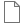 or **Project menu > New**).

1. Save the project (**Project menu > 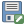 Save As...**) with a name like `tutorial1.qgz`. While you can save the project anywhere you like on your computer, you'll want to be a bit choosier when it comes to your geodata files later on (more on this [below](#saving)). For now, I'd recommend creating a folder somewhere for all your GIS stuff, and creating another inside that for your tutorial projects.

### Adding a basemap

We want a background for our map so that we can see where our geographical features are located. (One doesn't always need a basemap, but usually it's helpful.) For the ancient Mediterranean, the two options are a basemap produced by [the Consortium of Ancient World Mappers (CAWM)](https://cawm.lib.uiowa.edu/index.html), which tries to accurately reconstruct the ancient coastline, and [a basemap produced by DARE](https://ancientworldonline.blogspot.com/2014/04/digital-atlas-of-roman-empire.html), which includes labels with many ancient Roman names. We will use the CAWM map.

1. There are two main methods for adding this and most other freely-available basemaps, but not all basemaps can be added by each method. Since the CAWM basemap can be added by *both* methods, I'm providing both options here so that you have the basic instructions for other basemaps that you may want to use.

    * **Option 1: Using WMTS**
    1. Click 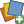 or under the **Layer menu**, click on **Data Source Manager**.
    1. Choose 'WMS/WMTS' in the lefthand menu, and click on <kbd>New</kbd> to add a new layer.
    1. In the 'Name' field, write "CAWM basemap" (or anything else you might want to call it).
    1. In the URL field, put: https://cawm.lib.uiowa.edu/wmts
    1. Click <kbd>OK</kbd>.
    1. Now click the <kbd>Connect</kbd> button underneath the name of the new map.
    1. It should automatically switch to the 'Tilesets' tab, but if not, choose 'Tilesets' at the top of the window.
    1. Select the only layer listed (some maps will have multiple layers), and click <kbd>Add</kbd> at the bottom of the window. The basemap will be added to your empty project.

    * **Option 2: Using XYZ**
    1. Click  or under the **Layer menu**, click on **Data Source Manager**.
    1. Choose 'XYZ' in the lefthand menu, and click on <kbd>New</kbd> to add a new layer.
    1. In the 'Name' field, write "CAWM basemap" (or anything else you might want to call it).
    1. In the URL field, put: http://cawm.lib.uiowa.edu/tiles/{z}/{x}/{y}.png (Note that you can tell if a basemap requires XYZ because it will have that `{z}/{x}/{y}` in the URL!)
    1. Untick 'Max. Zoom Level' (this isn't required, but it will help to keep the map from disappearing when you zoom way in; some XYZ services will tell you their minimum and maximum zoom levels, and you can fill those in).
    1. Click <kbd>OK</kbd>.
    1. Click <kbd>Add</kbd> at the bottom of the window. The basemap will be added to your empty project.

    <figure>

    <kbd>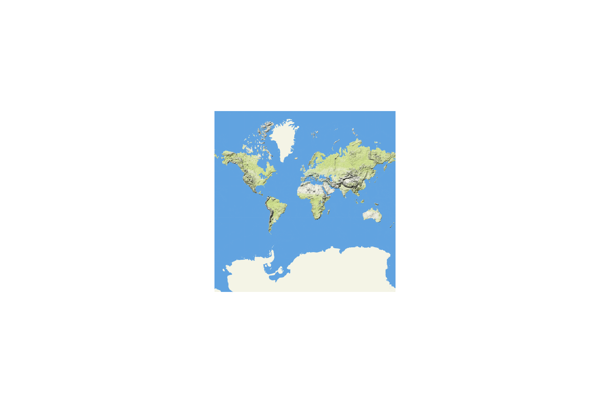</kbd>
    
    <figcaption><b>The newly-loaded basemap.</b>
    </figcaption>
    </figure>

    Once you have gone through either process once, the connection is stored in QGIS; for future maps, you can simply double click on the layer in the Browser panel to add it.

1. **Save your project!** (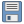 or **Project menu > Save**.) Saving frequently is very important, as QGIS can sometimes crash. You don't want to lose lots of hard work!

1. Zoom into the area around Greece and the Mediterranean (you can double-click with the default hand icon (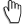), or select the zoom magnifying glass (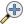) and single-click).

### Downloading and adding data

Pleiades is a good source for specific ancient world point locations; the AWMC is a good source for things like bodies of water or political regions that are best represented as lines or polygons. We will be adding data from both sources in this tutorial.

#### AWMC

1. From [the AWMC GIS Data page](https://awmc.unc.edu/gis-data/), click on 'AWMC Geodata Github Repository'. (You can also [go there directly](https://github.com/AWMC/geodata), but it's good to know how to find it.)

    If you think you'll want to use a lot of files from the repository, you can download the entire thing from the main page by clicking on the green 'Code' button and then selecting 'Download ZIP'. However, we'll only be working with a few files, which we will download individually.

1. Go to the 'Physical Data' folder.

1. We will be downloading **inland water**, so go to the 'inland_water' folder.

    There are two different versions of this file: a shapefile (in `.zip` format) and a GeoJSON file. We'll download both of them.

1. Click on the `inland-water-OSM.geojson` file. It should show you a map, although larger files will not do so.

1. Click on the download icon () at the top of the page.

    Depending on your browser and your setup, you may be prompted to save the file, or it may automatically save somewhere on your computer (e.g., a Downloads folder). However, we don't want the file just anywhere: file locations are important, as is not needlessly replicating data all over your computer.
    
    The specific directory names and locations on your computer that I provide in the following instructions are not themselves required: what's important is to have your files in a tidy and logical structure that enables you to know their original sources and locate them easily on your computer.

1. Inside the GIS folder you created earlier on your computer, create another folder called **AWMC Data** (or another similar name). Save the file here, or move it here if it was automatically saved somewhere else.

1. Follow the same process with the other file (which will not show you a map when you click on it).

1. On your computer, open the .zip file to see its contents. It contains **multiple** files. A so-called "shapefile" is actually multiple files, and they need to stay together. (You don't need to extract the contents; QGIS can automatically read it. However, if you ever have an unzipped shapefile, you can either treat the file ending as .shp as representative of the full shapefile, or zip the five files together.)

1. In your QGIS project, go to **Layer menu > Add Layer > 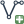 Add Vector Layer...**

1. Make sure that 'File' is selected under Source Type and that 'Automatic' is selected in the drop-down Encoding menu.

1. Click the <kbd>...</kbd> button at the far right of the Vector Dataset(s) field.

1. In the file selection window, navigate to the **AWMC Data** folder you created earlier. Select the geojson file and click Open (or double-click it).

1. Leave all the choices under Options as their default settings, and click Add. The data will be added to your map.

1. Follow the same process to add the shapefile .zip file to your map. (There won't be any options listed, this time.)

1. Close the Data Source Manager by clicking <kbd>Close</kbd>.

    <figure>

    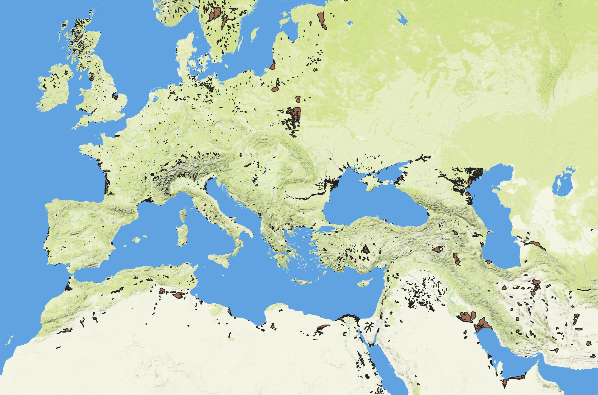

    <figcaption>
    <b>Inland water added.</b>
    </figcaption>
    </figure>

1. If the Layers panel is not open in QGIS, go to **View menu > Panels** and tick the **Layers Panel** box.

    The two inland water layers should be listed above the basemap in your Layers panel (and, accordingly, visible above the basemap); if not, drag them above the basemap in the Layers panel. (If you're having trouble dragging, you can also right-click the layer and choose 'Move to Top'.)

1. In the Layers panel, untick the box for the top layer. Notice that the layer beneath it, which is now revealed, appears to be identical except for the color &ndash; QGIS assigns colors randomly when it imports most vector files. (You'll learn how to change the colors in a future tutorial.)

    There are minor differences between these two files (primarily the number of significant digits included in some attributes), but to all extents and purposes, these two files are the same.

    Since GeoJSON is the more modern and flexible format, that's the one we'll use.

1. Delete the shapefile (it's the one with .shp at the end of its name in the Layers panel): select that layer in the Layers panel and click  at the top of the Layers panel (you can also right-click the layer to open the context menu, and choose 'Remove Layer').

1. On the AWMC GitHub page, go back to the main directory and download `Physical Shapefiles Apr 2024.zip` following the same process as before.

1. Add the file to your map following the earlier instructions. Notice that this time QGIS prompts you to select which layers you want &ndash; this .zip file contains *multiple* shapefiles. Select **only** the two river layers: one is called `river polygons/rivers_polygons_final` and the other is called `rivers/awmc-osm-rivers`.

    <figure>

    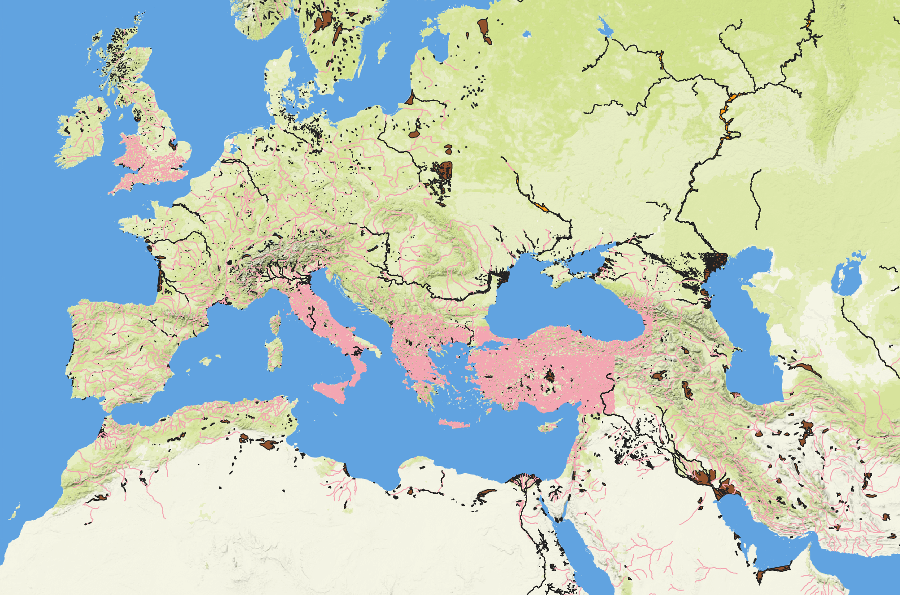

    <figcaption>
    <b>River lines and polygons added.</b>
    </figcaption>
    </figure>

#### Pleiades

For Pleiades, there are two methods for acquiring data: one is useful if you only want a few locations, and the other is useful if you want a lot of locations. We'll try both.

1. Go to the main Pleiades website at https://pleiades.stoa.org/.

    ##### <u>Individual sites</u>

1. First we want to find information for Delphi, the oracular center of the Greek world. Type 'Delphi' into the search box and scroll down to the result that says "Delphi = 540726". Click on the hyperlinked number.

    The number is this location's **Pleiades ID number (PID)**, which serves as a unique identifier for that particular place, allowing us to disambiguate ancient Greek Delphi from, say, modern-day [Delphi, Indiana](https://en.wikipedia.org/wiki/Delphi,_Indiana).

1. Click on the URL in the address bar and, at the end of the address, after the number, add `/json`. Hit return.

    <figure>

    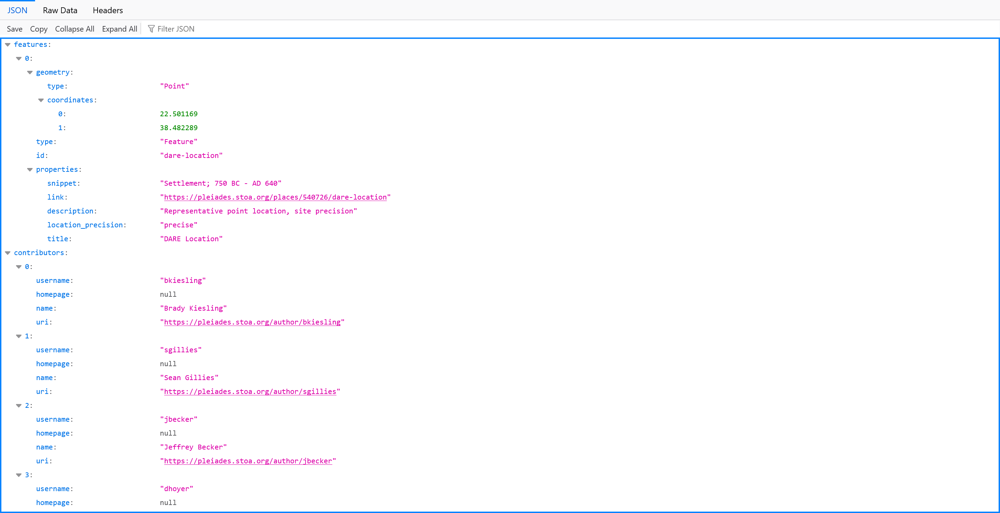

    <figcaption>
    <b>Delphi GeoJSON representation.</b>
    </figcaption>
    </figure>

    The data that you are now looking at is the GeoJSON representation of the point marking the Temple of Apollo at Delphi, which was marked as a blue and red crosshairs on the previous page. 

1. In the **GIS** folder on your computer, create a new **Pleiades Data** folder, and inside that folder create another **Individual sites** folder. (Again, you can use different names if you prefer.) Save the Delphi JSON file to this folder as `delphi_540726.json`.

1. Add the Delphi file to your map following the same process as before. There should now be a round dot just north of the Greek Peloponnese.

    <figure>

    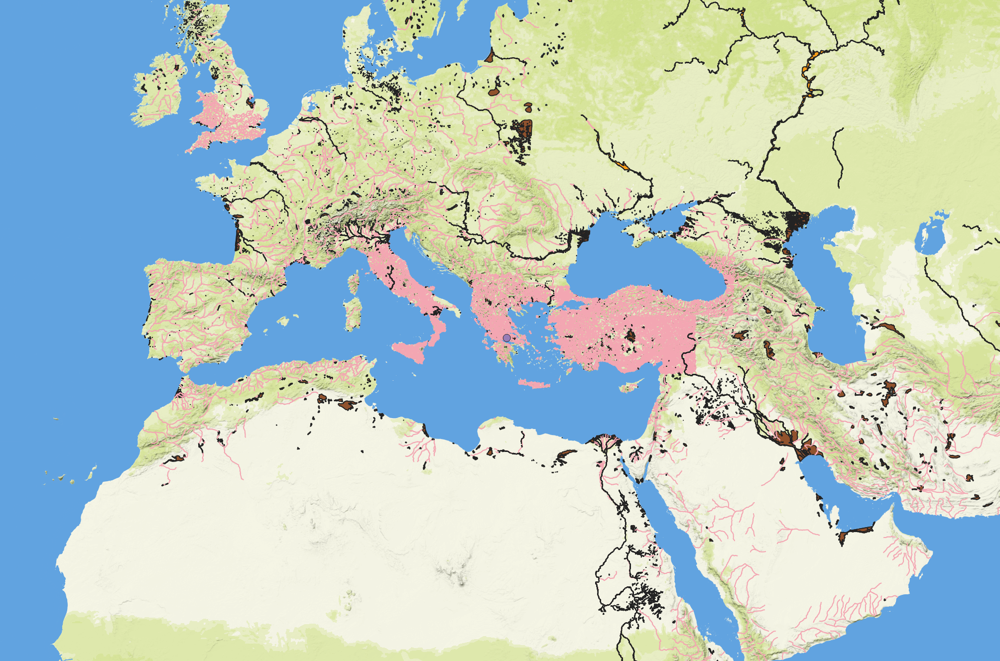

    <figcaption>
    <b>Delphi point added.</b>
    </figcaption>
    </figure>

    ##### <u>Full dataset</u>

1. From any Pleiades page (the main site or the Delphi page), click on 'Downloads' in the top menu bar. Scroll down to "Pleiades Data for GIS and General Use (CSV)" and follow the link following 'Get more information and download the latest version'.

1. Read this page up through the 'Files' section.

1. Download `pleiades_gis_data.zip` anywhere you like.

1. Make a new **GIS data** folder inside your **Pleiades Data** folder.

1. Inside the .zip file you downloaded is a 'data' folder, and inside that is a 'gis' folder. Transfer/unzip the contents of that inner 'gis' folder into your new **Pleiades data > GIS data** folder.

1. Follow the instructions under 'Quick Start' on the '*Pleiades* Data for GIS' page to add the points to your map. (When it says to load `places.csv` as delimited text, it means to choose **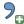 Add Delimited Text Layer** under the QGIS Layer menu, or to select Delimited Text in the Data Source Manager. If 'Point coordinates' is not automatically selected under 'Geometry Definition', you will need to choose it.)

    You should now have a map full of points!

    <figure>

    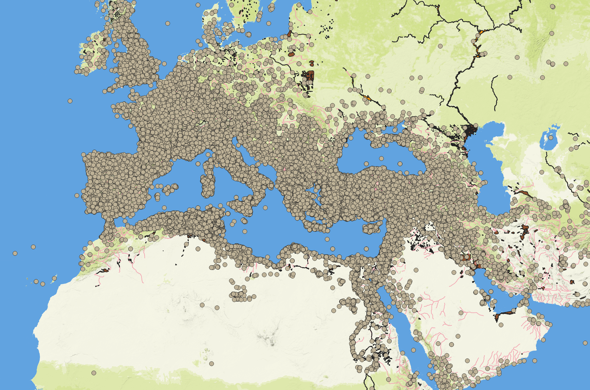

    <figcaption>
    <b>Pleiades data added.</b>
    </figcaption>
    </figure>

1. Delete the individual Delphi point layer from your map; that point is contained within this larger dataset.

    ##### <u>Exploring the data</u>

1. Make sure the 'places' layer is selected, then click on 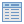, or go to **Layer menu > Open Attribute Table**, or right-click on the 'places' layer in your layers panel and select 'Open Attribute Table'.

    <figure>

    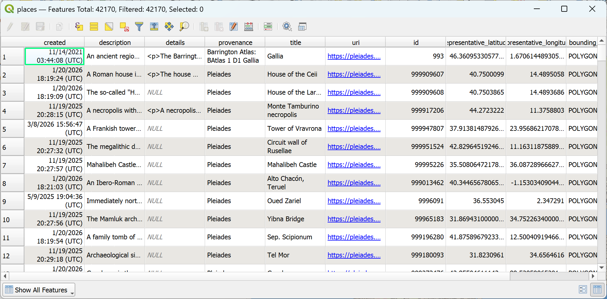

    <figcaption>
    <b>Pleiades places attribute table.</b>
    </figcaption>
    </figure>

    Each of the rows contains information about one point in the dataset; each column in the row contains a piece of information about that point, such as a description of the site, its name, its latitude or longitude, or its Pleiades ID (PID) value.

1. Close the attribute table.

### Joining data

You may have noticed that the Pleiades GIS Data page talks about using joins to attach other files and get more information about the points. As noted above, each Pleiades place has a unique numerical ID, its PID. Each of the files in the GIS data package contains additional information about many of the points, referenced by that PID. We therefore can use that value to connect the files to each other and thereby enrich our points with additional information.

1. From your downloaded Pleiades GIS Data files, add `places_place_types.csv` and `names.csv` as Delimited Text. **Important: Under 'Geometry Definition', make sure to select 'No geometry (attribute only table)'.**

1. Right-click on the 'places' layer and select 'Properties...'

1. In the Layer Properties window, select Joins from the lefthand menu.

1. Click on the green <kbd></kbd> at the bottom of the window. In the 'Join layer' dropdown menu, choose 'places_place_types' and make sure that 'place_id' is selected in 'Join field'. In the 'Target field' menu, choose 'id'.

1. Select the 'Custom field name prefix' box and delete the text in the field below it (if the field isn't visible, click the black arrow next to 'Custom field name prefix'). Click <kbd>OK</kbd>, and then click <kbd>OK</kbd> again to close the Layer Properties window.

1. Open the attribute table again and scroll to the last column. There should now be an additional column called `place_type` &ndash; this was added thanks to the join.

1. Close the attribute table.

1. Open the attribute table for the 'names' layer. Notice that the first two entries ('Gallia' and 'Galli') are both for PID 993.

1. Close the attribute table for the 'names' layer, and join the 'names' layer to the 'place' layer following the steps above. This time, Join layer = 'names', Join field = 'place_id', and Target field = 'id'; leave 'Custom field name prefix' unchecked.

1. Open the attribute table for 'places'. Click on the <kbd>id</kbd> column to sort the table by PID, and scroll down to PID 993. Which name(s), listed in column `names_title`, got successfully joined to item 993?

    As you can see, although we can join the 'names' layer to the 'places' layer, we can't do so entirely successfully using this particular joining tool, which can only make one-to-one joins (where there's exactly one item on either side of the equation). If there's a one-to-many join, we'll need to use another tool. We're not going to do that now.

1. Remove the 'names' join by going to Joins in the Properties for the 'places' layer, selecting the 'names' join, and clicking the <kbd></kbd> button.

### Filtering data

Obviously one rarely needs *all* of the Pleiades data. We can filter it based on the datapoints' attributes, location, or other aspects to only show some of the data. In this case, we'll select all the religious spots (temples, sanctuaries, and shrines) based on the value of `place_type`.

1. At the top of the 'places' attribute table, click on <kbd>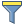</kbd>.

    This form allows you to specify the values on which you want to filter. If you click on the <kbd>Exclude Field</kbd> button at the end of any field, you can see the options that you have for matching criteria: you can specify a precise value (e.g., setting `id` to *Equal to (=) **540726*** would select only Delphi), or a partial string contained within a value (e.g., setting `title` to *Contains **del*** would select Delphi, Delos, Philadelpheia, etc.), or various other matching (or excluding) options.

1. Scroll down to the last field (`place_type`) and type 'sanctuary' into the box (the button at the end of the field should automatically change to <kbd>Contains</kbd>).

1. Click <kbd>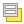 Select Features</kbd> at the bottom of the window.

1. Repeat the above steps, using 'shrine' as the new value, but instead of clicking 'Select Features', click the dropdown arrow at the right side of that button and choose 'Add to Current Selection'.

1. Do the same for 'temple'. In this case, notice that there are two phrases that come up in the search box ('temple' and 'temple-2') &ndash; using `Contains` as the search predicate allows 'temple' to find both.

1. Do the same for 'tomb'.

    A number of the points (over 1800) should now be highlighted in yellow.

    <figure>

    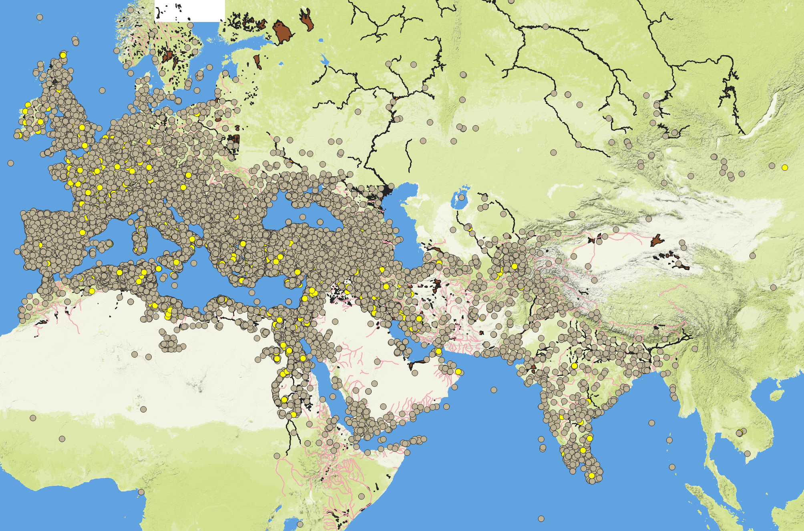

    <figcaption>
    <b>Selected religious locations</b>
    </figcaption>
    </figure>

1. Since these sites are the only sites from Pleiades that we are (currently) interested in, we now want to save them as their own layer. (This will also make the place-type join permanent for these sites.) Right-click on the 'places' layer in the Layers panel, and move your mouse down to 'Export' in the context menu. In the secondary menu that comes up, choose 'Save Selected Features As...'.

1. In the 'Save Vector Layer as...' window that comes up, make sure that Format is set to 'GeoPackage' (this should be selected by default), and type 'religious sites' as the Layer name. For File name, click on the <kbd>...</kbd> at the right of the field, and navigate to the tutorials directory where your QGIS project is saved. Save the file as `tutorial_1.gpkg`. Leave all the other default options unchanged, and click <kbd>OK</kbd>.

    You should now have a new layer on top of your old layer that contains only the religious sites that you filtered for in the previous steps. If you uncheck the 'places' layer in your Layers panel, only the religious sites will be left visible.

    <figure>

    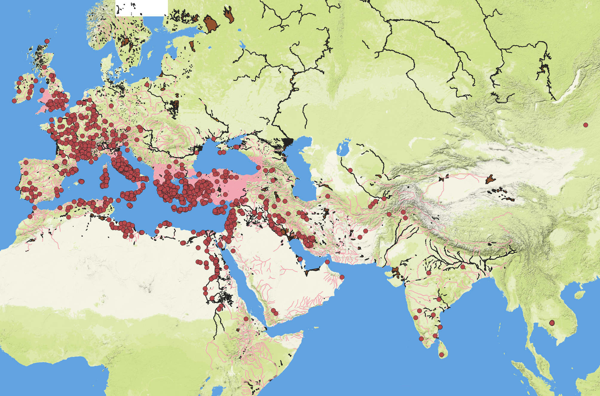

    <figcaption>
    <b>Religious locations</b>
    </figcaption>
    </figure>

Be sure to save your project.

## Submission Instructions

1. Right-click on your religious sites layer and choose 'Zoom to Layer(s)' at the top of the context menu.

1. Take a screenshot of your full QGIS window (including the Layers panel), save it as either a .jpg or a .png file, and submit it on CourseWorks, together with your GeoPackage file. (Instructions for taking a screenshot [on a Macintosh are here](https://support.apple.com/en-us/102646) and [on a Windows 10 or 11 computer are here](https://support.microsoft.com/en-us/windows/apps/use-snipping-tool-to-capture-screenshots).)