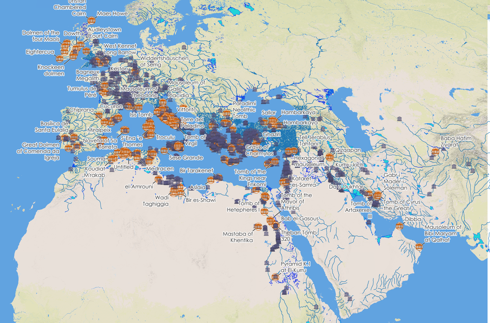
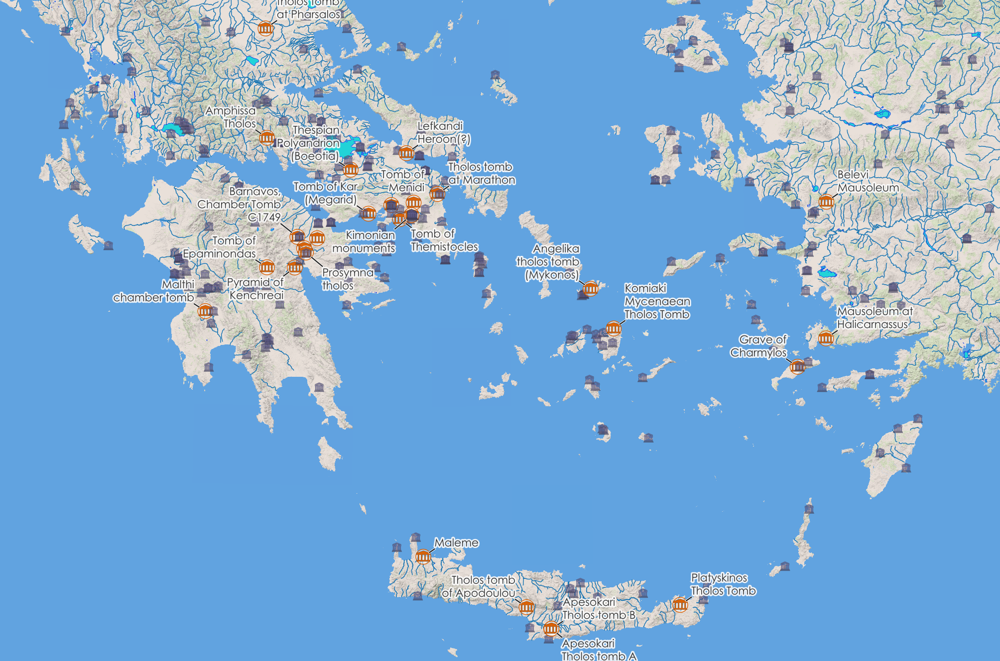
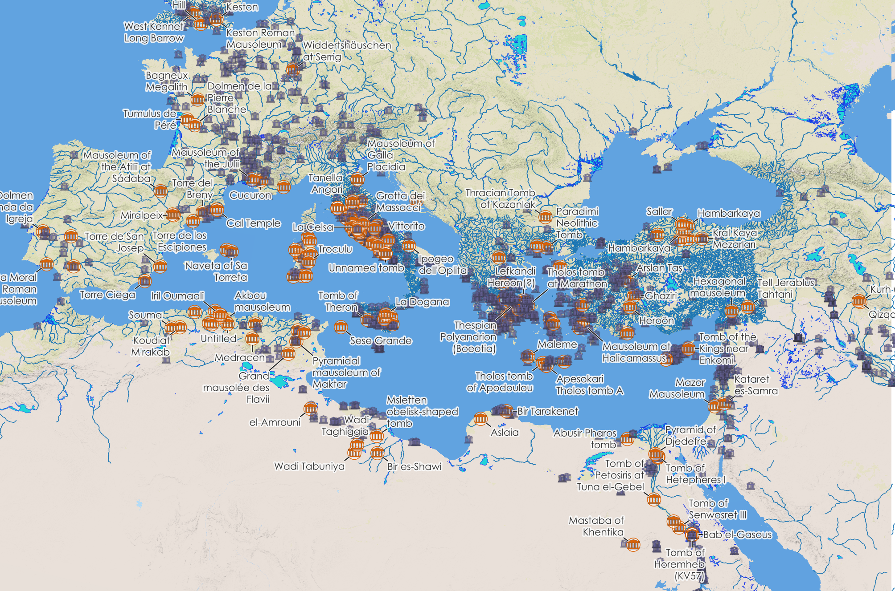
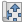
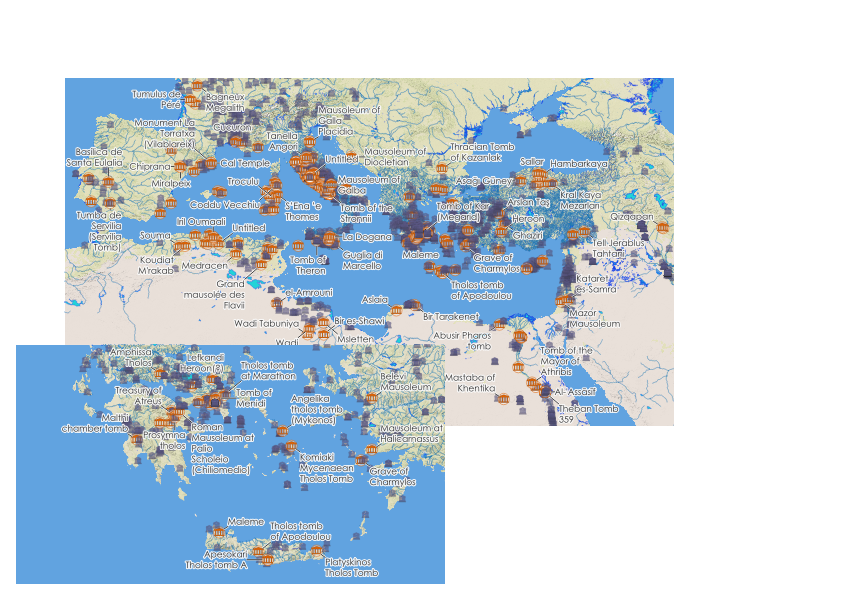
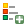
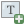
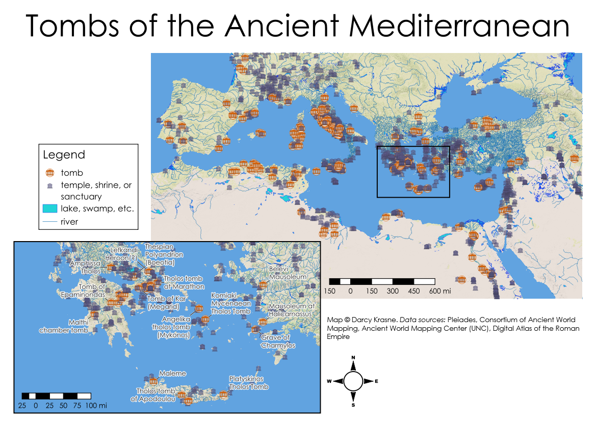

# Symbology, print layout, and aesthetics

## Learning Objectives
In this tutorial, you will learn how to:
- Apply customized colors and styles to features (points, lines, and polygons).
- Add and style labels for features.
- Set an appropriate map coordinate reference system.
- Design a static map using Print Layout.

## Tutorial

Our goal in this tutorial is to make a map of tombs and other religious sites from the ancient Mediterranean. In doing so, we will apply the rules of visual hierarchy as they pertain to [maps](https://web.archive.org/web/20171222052408/https://www.ordnancesurvey.co.uk/resources/carto-design/clear-visual-hierachy.html) and [layouts](https://ixdf.org/literature/topics/visual-hierarchy) (please click on and read these links!) to make sure that our map is easily readable.

1. Open the project from Tutorial 1, and use Save As to save it as a new file called `tutorial2.qgz`.

    This is actually unnecessary &ndash; you could keep working in your first file &ndash; but while you're learning you should keep your work for each tutorial separate.

### Modifying symbology: colors

Our first step will be to change the appearance of the symbols for points, lines, and polygons from their default colors, since the random browns, greens, oranges, pinks, etc. that QGIS has assigned are not necessarily appropriate for our features.

1. Open the Properties for the inland water layer. (You can do this using right-click and selecting from the context menu, as we did in the last tutorial, or you can simply double-click on the layer name.)

1. Go to 'Symbology' in the left-hand menu.

    Your symbology is currently a simple color fill, specified in the window as **Fill > Simple Fill**, with a **patch** at the left of each showing the color. There are ways to get very complex with this, such as combining multiple patterns and colors, but for the moment, we will just change the colors.

1. Click on 'Simple Fill'.

1. In the 'Symbol layer type' dropdown menu, try clicking on the various different types of fill to see how they change the large patch on the top left and the layers contained within the symbol at the top right. Then return to 'Simple Fill' in the menu.

1. Click on the small dropdown arrow <kbd></kbd> at the right of the 'Fill color' dropdown. You should see a color triangle inside a color wheel, plus various preset color patches.

1. Click again to close the dropdown, then click on the color strip itself. A new window should open up that allows you to choose color by a more nuanced method.

1. Using either method, set the fill color to any light blue. (If you're color blind, then use the second method, and in the 'HTML notation' box, write `#33a0d8`, which is [the **hexadecimal code**](https://en.wikipedia.org/wiki/Web_colors) for a medium light blue.)

1. If you used the first method, click outside of the color-picker to close the dropdown panel, and if you used the second method, click <kbd>OK</kbd> to close the color-choosing window. Click <kbd>Apply</kbd> at the bottom of the symbology window.

    On your map, you will see that the color of all the bodies of water has now changed to your newly-selected light blue. You don't have to click 'Apply' every time, but you can do so if you want to see how the style looks before closing the window.

1. Click on the 'Fill style' dropdown to see the options. You can use these if you want to use a pattern instead of a solid color, but for now we will leave this as a solid blue.

1. Following the same method as before, change 'Stroke color' to a darker blue. (You can use the hex code `#1226ea` if you want.) Optionally, click <kbd>Apply</kbd>.

1. Change 'Stroke width' to .13.

1. Click <kbd>OK</kbd> to apply the style and close the Properties window.

    <figure>

    

    <figcaption>
    <b>Inland water symbology.</b>
    </figcaption>
    </figure>

    Remember to save frequently!!

1. Change the fill color for river polygons to another blue (you can use `#1f78b4` if you want), and this time make a note of the hex code (you can always find out what it is by just hovering over the 'Fill color' color strip, or else by opening the color-choosing window).

1. In the 'Stroke style' dropdown menu, choose 'No Line'.

1. Click <kbd>OK</kbd> to apply the style and close the Properties window.

1. Open the Symbology for the river lines (`awmc-osm-rivers.shp`) and change the Simple Line color to the same color you used for your river polygons, by giving it the same hex code number.

1. Change 'Stroke width' to .2, and click <kbd>OK</kbd>.

    <figure>

    

    <figcaption>
    <b>River symbology.</b>
    </figcaption>
    </figure>

### Modifying symbology: shapes

In the previous part of the tutorial, we customized the fill and outline colors of our polygon and line symbols, and we could do the same for our points.  However, maybe we want points that are more representative of the features they symbolize, rather than simple round circles. We can also customize the shape, if we want.

1. Open the Symbology properties for your religious sites layer.

1. Select Simple Marker in the layer tree at the top of the window, and in the 'Symbol layer type' dropdown, choose 'SVG Marker'.

1. Scroll down in the window until you see the set of icons that you can choose from. For the moment, we will use the 'tourist monument' icon  (because it looks like a Greek temple).

1. Scroll back up, and set Width and Height to 4.0 millimeters (you can just change one and the other will change automatically, since currently they are locked together).

1. Change 'Fill color' to a deep red (e.g., `#9d0414`), and change 'Stroke width' from 'No stroke' to 0.05.

1. Click <kbd>Apply</kbd>; you should see all the markers change to your chosen icon.

    <figure>

    

    <figcaption>
    <b>Custom point symbology.</b>
    </figcaption>
    </figure>

    However, maybe we want to distinguish between our different types of religious site &ndash; remember, we have temples, shrines, sanctuaries, and tombs, and right now we can't visually tell the difference between them.

1. At the very top of the Symbology window, change  Single Symbol to  Categorized.

1. In the new 'Value' dropdown menu, choose 'place_type' (you may need to scroll down).

1. Underneath the large empty window, click <kbd>Classify</kbd>.

    The window will fill with different colors of your icon, one for each value of the `place_type` attribute.

1. Untick the box for 'all other values' and click <kbd>Apply</kbd>.

    <figure>

    

    <figcaption>
    <b>Categorized point symbology.</b>
    </figcaption>
    </figure>

    We can already see here what a difference it makes to categorize the features &ndash; some areas have clusters of tombs, others have clusters of temples, and others have very mixed types of religious locations. At the same time, if we read the definitions of temples, sanctuaries, and shrines in the [Pleiades Feature Categories page](https://pleiades.stoa.org/vocabularies/place-types), the difference between them is not necessarily very clear &ndash; it may depend on the perspective of the person who labeled the site. (And, of course, there is no obvious difference between `temple` and `temple-2`.)

    Given this lack of clarity, we want to use one symbol for those various religious sites and a different symbol for tombs. There are various ways to achieve this; we will do the simplest one.

1. In the classification window, select all of the values *except for* 'tomb' and 'all other values' and click <kbd></kbd>. You should be left with only 'tomb' and 'all other values' in the window.

1. Tick the box next to 'all other values'.

    It's kind of hard to make out the tombs amidst all of the other symbols. We'll make the tomb symbol more visible in a few ways.

1. Double-click the symbol next to 'all other values'. In the Symbol Selector window, set Opacity to 90%, set Size to 3mm, and set the marker color to a lavender or purple (e.g., `#7570b3`). Click <kbd>OK</kbd>.

1. Double-click the empty space under 'Legend' to the right of the text 'all other values' and write **temple, shrine, or sanctuary**. (Caution: don't replace 'all other values' or the icons will disappear.)

1. Double-click the symbol for 'tomb'.

1. Select the SVG Marker and change the Fill color to a dark orange (e.g., `#d95f02`), and change the marker itself to the 'tourist museum' icon .

1. At the top of the Symbol Selector window, click <kbd></kbd> to add a new layer to the marker.

1. If necessary, use the <kbd></kbd> or <kbd></kbd> arrows to put the new simple marker *below* the SVG marker.

1. Select the new simple marker and make the size 4mm, make the stroke color the same dark orange as your SVG marker, make the fill color white (`#ffffff`), and make the stroke width 0.2mm.

1. Click the composite Marker at the top of the layer tree and set the opacity to 98%. Click <kbd>OK</kbd>, and click <kbd>OK</kbd> again to set the symbology and close the Properties window.

    <figure>

    

    <figcaption>
    <b>Custom symbology for tombs.</b>
    </figcaption>
    </figure>

    The temples are now much more visible against all the other points for religious sites, and the denser clusters of sites can be observed more clearly as well.

    > ##### Choosing colors
    > Map colors should be chosen both for aesthetics and accessibility. We used blues for the rivers and bodies of water because (of course) water is traditionally depicted in blue. For the sites, however, the important thing is to choose colors that both stand out against the background and are easily distinguished from each other, [including for people with various forms of colorblindness](https://www.datawrapper.de/blog/colorblindness-part1). While there are many possible shades to choose from, my recommended shades of purple and orange are drawn from [ColorBrewer](https://colorbrewer2.org), a site where one can find sets of contrasting shades that work for colorblindness, black-and-white printing, etc. This is a good site to become familiar with when choosing colors for maps.

### Adding labels

1. Open the Properties for your religious sites layer and go down to Labels in the left-hand menu.

1. In the dropdown menu at the top of the window, change from  No Labels to  Single Labels.

1. In the new Value dropdown menu, choose `title` and click <kbd>Apply</kbd>.

    <figure>

    

    <figcaption>
    <b>Basic labels.</b>
    </figcaption>
    </figure>

    This is a good start, but we just want to label our tombs, and we want to make the labels more legible &ndash; currently only the ones over lighter, uncluttered backgrounds are easy to read.

1. In the top dropdown menu, change to  Rule-based Labeling.

1. There should already be one rule in the list, with the rule '(no filter)' (if not, use the <kbd></kbd> button to add one); select it and click <kbd></kbd> to edit the rule.

1. Give the rule a meaningful description such as 'tombs only'.

1. Make sure that the radio button next to Filter is selected, and type `"place_type" = 'tomb'` into the field. (The double vs. single quotation marks and [lack of] capitalization are all critical to match exactly.) If you want to make sure that you've typed it correctly, you can click <kbd>Test</kbd>; it should return several hundred features.

    > #### Expressions
    > QGIS allows you to build very simple or very complicated expressions in order to select features and attributes for various different tools. If you want to build a more complex expression, you can click the <kbd></kbd> and use the Expression Builder tool, which [you can read about in depth here](https://docs.qgis.org/3.44/en/docs/user_manual/expressions/expression.html). It is helpful, but not required, to know something about [SQL expressions](https://en.wikipedia.org/wiki/SQL_syntax).

1. Scroll down in the Edit Rule window, and make sure that 'title' is selected in the Value box.

1. Below the Lorem Ipsum text, make sure that  Text is highlighted in the lefthand menu. To the right of the menu, change the Font to any [sans-serif font](https://en.wikipedia.org/wiki/Sans-serif) that you find appealing (the default is Open Sans; you can leave that if you like).

1. Set Size to 3.25mm (change Points to Millimeters in the dropdown menu).

1. In the lefthand menu, select  Buffer.

1. Tick the 'Draw text buffer' box.

1. Change Size to 0.8mm and Opacity to 90%.

    If you want to see the effect that these changes will have, you can change the background color of the Text Sample box by clicking the color bar underneath it and choosing a color other than white. This allows you to see the preview more clearly.

1. Some of the names are very long. Select  Formatting in the lefthand menu, and scroll down to the 'Wrap lines to' field. Set it to 15 characters and ensure that Maximum line length is selected.

1. Select  Placement in the lefthand menu and set Distance to 1mm and Maximum distance to 5mm. Scroll down to Label Spacing and set it to 2mm.

    Since our labels now may not be right next to our features (setting the maximum distance allows the label to move further away), we need to add some leader lines to show which label goes with which feature.

1. Select  Callouts in the lefthand menu, and check the box next to Draw callouts.

1. Set Minimum length to 2.5mm, and set Offset from feature to 2mm.

1. Click on the line in the Line style button and add a second simple line using the <kbd></kbd>.

1. Select the lower of the two simple lines, and set its color to white (`#ffffff`) and its opacity to 80%, following the same methods we used for setting symbology colors.

1. Set the Stroke width to 6mm.

1. Select the upper of the two simple lines and set its Stroke width to 3mm.

1. Click <kbd>OK</kbd>

1. Click <kbd>OK</kbd> to apply your changes and close the Properties window.

    <figure>

    

    <figcaption>
    <b>Tomb labels.</b>
    </figcaption>
    </figure>

    There are many other aspects of the labels' appearance and placement that you can customize; for more complete information, refer to [the QGIS manual](https://docs.qgis.org/latest/en/docs/user_manual/style_library/label_settings.html). The main principles to be aware of are all to do with accessibility:
    - use a sans-serif font
    - don't use too small of a font size
    - use buffering and/or backgrounds to aid legibility against complicated or multicolored backgrounds
    
    In aesthetic terms, you should always play around with your labels to see what looks best in the context of your map.

### Setting the coordinate reference system

In order to decide what [coordinate reference system (CRS)](https://docs.qgis.org/latest/en/docs/gentle_gis_introduction/coordinate_reference_systems.html) we want to use for our map, we need to consider various aspects: how much and which part of the world we're dealing with; whether the map is for display, analysis, or travel; etc. In this case, the map is for display, and we're going to show most of the ancient Mediterranean. That means we'll be best served by a custom CRS, due to the large lateral extent of the Mediterranean, but first we'll learn how to apply an official CRS that's already stored in QGIS.

Currently our map is in EPSG:3857, or "Pseudo-Mercator," which is the standard CRS for all web maps; since the first layer we added was the basemap, which natively exists in that CRS, our map was automatically assigned that projection. (If we'd added our data first, by contrast, our map would currently be in EPSG:4326.)

We can reproject our map into a different CRS. We'll start with an Equal Earth projection, which [replaced Mercator as the official UN standard](https://stuartdunn.blog/2026/09/07/projecting-emotions-mercator-and-equal-earth/) in 2026.

1. Go to **Project menu >  Properties** and choose  CRS in the lefthand menu.

1. Under Predefined Coordinate Reference Systems, scroll down to ***Projected***, click on it to open it, and then scroll to *Equal Earth* and click on it to open it.

1. Under *Equal Earth*, select WGS 84 / Equal Earth Greenwich, with the Authority ID EPSG:8857. Click <kbd>OK</kbd>.

    <figure>

    

    <figcaption>
    <b>Equal Earth (Greenwich) projection.</b>
    </figcaption>
    </figure>

    Equal Earth projections maintain an accurate *area* for all parts of the earth, but visually the features may look distorted. The most noticeable difference in the region of the ancient Mediterranean is the orientation of the Caspian Sea (now seemingly angled NW to SE, rather than running directly North-South), but Saudi Arabia and the visible portion of Africa have also lengthened somewhat.

    All countries have one or more official Coordinate Reference Systems, which are used for mapping that country (or portions of it). Now we'll transform the map into the official CRS for Greece ("Greek Grid"), which perfectly preserves the shape of Greece.

1. Open the CRS window again, and type 'Greek' into the Filter bar at the top. Choose GGRS87 / Greek Grid (EPSG:2100) from the results and click <kbd>OK</kbd>.

    <figure>

    

    <figcaption>
    <b>Greek Grid CRS.</b>
    </figcaption>
    </figure>

    If we just want to show ancient (or modern) Greece, this is a great CRS to use. But if we want the entire Mediterranean, it doesn't work quite so well, and no other official CRS does a great job for that region, either. We'll create a custom CRS that's set for the parameters of our region of interest.

1. In your web browser, visit [https://projectionwizard.org/](https://projectionwizard.org/).

1. On the map, drag the corners of the box so that the left side is just west of Portugal, the top is just above the Sea of Azov (ancient Lake Maeotis), the right side is about halfway across the Caspian Sea, and the bottom is about halfway down Egypt. (You can zoom in on the map to make the selection easier.)

1. Select the radio box under Distortion Property for Conformal.

1. Under the line "Conformal projection for regional maps with an east-west extent," where it says Lambert Conformal Conic, click **WKT**, and copy the text in the box.

1. In QGIS, go to **Settings menu >  Custom Projections...**

1. Click <kbd></kbd>

1. In the Name field, give your new CRS a name like "Lambert CC: Ancient Mediterranean".

1. Under Definition, make sure that the Format is WKT (Recommended), and paste the text you copied from the Projection Wizard into the box. Click <kbd>OK</kbd>.

1. Go to the Project Settings to set your CRS (note that QGIS has a shortcut to get to this screen: a button at the bottom right of the QGIS window, with the  symbol and your current CRS), and scroll to the very bottom of the Predefined Coordinate Reference Systems box. Under ***User-defined***, choose your newly-defined CRS and click <kbd>OK</kbd>.

    <figure>

    

    <figcaption>
    <b>Custom Lambert Conformal Conic CRS for Mediterranean.</b>
    </figcaption>
    </figure>

    If you scroll your map around the rest of the world, you will see that it is oddly angled and distorted, but the Mediterranean region looks "normal."
    
    Notice that not all of the Pleiades data is contained within the bounds of our custom CRS; if you wanted to include the data from India or Britain, for example, you would need to change the boundaries of your box in Projection Wizard and create a new custom CRS in QGIS. (You can create as many as you like; give them names that reflect their boundaries, as well as their projection.)

1. Return your CRS to Pseudo-Mercator EPSG:3857.

### The print layout

If we want to produce a static map for display (as part of a paper or poster, on a website, etc.), we need to compose a layout that includes the map exactly as we want it to look and various additional features that allow an audience to read the map correctly.

All maps should always have a legend, a scale bar, a north arrow, and a credit line (identifying you as the creator of the map and indicating the sources of your data). Most maps will also need a title.

Items in the layout should be positioned according to their importance, following a "Z" shape across the layout starting at the top left (which is how our eyes are trained to track), in line with the principles of visual hierarchy (<a href="#visual_hierarchy">see above</a>). That means, for instance, that the title should go at the top of the page, in a large font, while the credit line should go at the bottom (or along a side), in a small font. It's also important to make use of white-space and empty areas of the map in order to give your layout a sense of balance.

1. Go to **Project menu >  New Print Layout...**

1. When prompted for a title, call it "tutorial 2 layout" (although you could call it anything else).

1. Right-click on the blank page and choose 'Page Properties...'. In the Item Properties to the right of the layout, make sure that the Size is set to A4 and the Orientation is set to Landscape (these are usually the defaults; if not, you can change them in the dropdown menus).

#### **Map boxes**

1. In the lefthand menu of the new layout, click , and draw a box on the blank page starting from about 1/3 down the page to near the bottom, and starting from near the left edge to about 3/4 of the way across the page. (You will next adjust the placement and size, so this is just approximate.)

1. Select the Item Properties tab in the menu to the right (it may already be selected), and under CRS, change Use Project CRS to your custom-designed CRS. (It should be available in the dropdown menu, since you've used it recently, but if not, click the <kbd></kbd> button and select it as we did previously.)

    > ##### Project CRS and the Print Layout
    > Normally, you can just set your CRS in the main project, and then use the project CRS in your layout. We are leaving the project in EPSG:3857 and changing it in the layout instead because we are going to have two map boxes, each with different CRS, and when using an XYZ basemap, this can cause issues. If you're using a WMTS basemap (look back at [the beginning of tutorial #1](./tutorial_1.md#adding-a-basemap) if the terms XYZ and WMTS are confusing!), or if you only have one map box, or if all your map boxes use the same CRS, you can set the appropriate CRS in the project and not worry about doing it in the layout.

1. Click  in the lefthand menu and then adjust the contents of the map by zooming and panning so that it shows approximately the same area that we defined for our custom projection. If you need to adjust the size of the box to better fit that area, click  in the lefthand menu and change the box size.

1. Draw another somewhat smaller map box, and set its CRS to Greek Grid (EPSG:2100).

1. Adjust the second map box by zooming, panning, and changing its dimensions so that it shows the Peloponnese, the southern edge of mainland Greece, the west coast of Asia Minor, and Crete.

1. Move the two map boxes so that the second map box is in the lower left corner of your layout and nests into the large empty desert region of Africa in the first map box, without covering any sites (it's okay if it covers labels).

    <figure>

    <kbd></kbd>

    <figcaption>
    <b>The Print Layout with two map boxes.</b>
    </figcaption>
    </figure>

1. Select the map box showing Greece, and scroll down in Item Properties to Frame; tick the box and set the thickness to 0.5mm.

#### **The legend**

1. Click  in the lefthand menu and draw a box in an empty space on the layout.

1. In the Item Properties tab, under Main Properties, write 'Legend' in the Title field.

1. Scroll down to Legend Items and uncheck the box next to Auto update.

1. In the Legend Items content box, select the 'names' and 'places_place_types' items and click <kbd></kbd> below the box.

1. Also remove 'places', the basemap, and the river polygons (keep the river lines).

1. In the Legend Items content box, right-click the heading 'tutorial_1 &mdash; religious sites' and choose 'hidden'.

    Your legend should now contain four items, plus its title.

1. Double-click 'inland-water-OSM' and change the name to 'lake, swamp, etc.', then click <kbd></kbd> to return to the legend.

1. Change the name of the river line to 'river'.

1. In Item Properties, scroll down to Fonts and Text Formatting. Under Legend Title, Click on Title Font and change it to the same font you used for your labels or to another font you like (it doesn't have to be sans-serif). Use <kbd></kbd> to return to Item Properties.

1. Change the Item Labels font to the same font you used for your labels.

1. If your legend overlaps a map or goes off the edge of the layout and you need to make it narrower, under Word Wrapping set Maximum length to 50mm.

1. If you like, you can put a border around your legend by scrolling down the Item Properties and ticking the box next to Frame.

#### **Scale bars and north arrow**

1. Select  and draw a box on top of one map box to add a scalebar.

1. Select the scalebar icon again and draw a box on top of the other map box.

    You now should have two scalebars, one linked to each map.

1. Select the scalebar for your overview map (that shows the entirety of the Mediterranean). In Item Properties, under Units, change Scalebar units to Miles.

1. Under Segments, set Segments to left 2, right 4, and set Fixed width to 150 units.

1. Under Appearance, set Label margin to 1mm and select Below Segment Edges for Distance label placement.

1. Click <kbd>Font</kbd> and set the font to the same font you used for your labels.

1. Do the same for the scalebar on the inset map, but its Fixed Width should be 25 units.

1. Drag each scalebar to a location near the edge of its associated map where it's not covering any features (e.g., open water or empty desert).

1. Select  in the lefthand menu and draw a box on an empty area of the layout.

1. In Item Properties, make sure that SVG image is selected, and choose arrows from the SVG Groups menu. Pick a north arrow that you like. (We only need one north arrow since both maps are oriented the same direction.)

1. Move the arrow somewhere that you think it looks good, and change the Fill color if needed to make its features visible against the white background.

#### **Bounding box**

1. Select  in the lefthand menu, choose  Add Rectangle, and draw a box around Greece and Crete on your overview map that more or less matches the extent of your inset map.

1. In Item Properties, click the color bar under Style and give it a transparent fill (0% opacity) and a 0.5mm stroke width. (Make sure not to change the opacity of the whole shape, just its fill, or you won't see anything!)

#### **Title and credit line**

1. Select  in the lefthand menu and draw a long rectangle at the top of your layout, above the overview map, from one edge of the layout to the other.

1. In Item Properties, change the default text to "Tombs of the Ancient Mediterranean".

1. In Item Properties, click Font, and choose the same font as you used for your legend title. Set the font size as large as it can be without the title going onto a second line.

1. Return to Item Properties and set Horizontal alignment to Center.

1. Draw another label box in the empty space at the lower right of your layout.

1. Change the default text to "Map by" and add your name. Then write "Data sources:" and list the sources of your data &ndash; make sure to include the sources of our location points, river lines and polygons, inland water polygons, and the base map. (Check [Tutorial #1](./tutorial_1.md) if you can't remember where anything came from!)

1. Set the font to the same font you used for the feature labels.

    > ##### Fine-tuning placement
    > If you're displeased in any way with the locations of any items on your layout &ndash; if, for instance, it feels unbalanced to you, or you decide the legend would catch attention better somewhere else &ndash; you can adjust their placement accordingly. Just make sure to keep a small margin around the border of the layout.
    >
    > If you need to move multiple items at once (e.g., the rectangle outline and the map it's on top of), select the first item and then shift-click any additional items that you want to move along with it. Alternatively, use the Items panel to select multiple items.
    >
    > If you would like to add guides to help you line things up, show you where 0.25in from the edge is, etc., you can use the Guides tab (next to the Item Properties tab) to add however many horizontal and vertical guidelines you want. These allow you to place your items with precision and do not show up on the final exported layout.

#### **Customizing the map box contents**

The last thing we need to do is remove the labels from our overview map, while keeping them in our close-up map of Greece. In order to do this, we need to return to the main QGIS window and set some Map Themes. (We also could have done this first or at any other point; it doesn't need to be last.)

1. In the main QGIS window, open the layer properties for your religious sites layer.

1. At the bottom of either the Symbology or Labels window, click <kbd>Style</kbd> and choose 'Add...'.

1. Give it the name 'with labels'.

1. Click <kbd>Style</kbd> again. Notice that the style 'with labels' has been added to the bottom of the list, after 'default', and is currently selected.

1. Add another Style called 'without labels'. (This is now automatically selected.)

1. Untick the box next to your tomb label. Click <kbd>Apply</kbd>.

1. Close Properties.

1. Click  in the Layers panel, and select Add Theme....

1. Give it a name like "without labels".

1. Right-click your religious sites layer, and in the context menu, go down to 'Styles (3)' and choose 'with labels' from the sub-menu.

1. Add another theme called "with labels".

1. Return to your print layout.

1. Select your inset map box. In the Item Properties tab, under Layers, tick the box next to 'Follow map theme' and choose 'with labels' from the dropdown list.

1. Do the same for your overview map box, but choose 'without labels'. After the map box finishes updating (it may take several seconds), the labels should disappear from that box.

    <figure>

    <kbd></kbd>

    <figcaption>
    <b>The final Print Layout.</b>
    </figcaption>
    </figure>

## Submission Instructions

1. Go to **Layout menu > Export as PDF...**. (If you get a message about the project containing WMS layers, just click <kbd>Close</kbd>.) Save the PDF in your Tutorials folder; you can leave all the defaults in the next screen, and click <kbd>OK</kbd>.

1. Submit the PDF on CourseWorks.