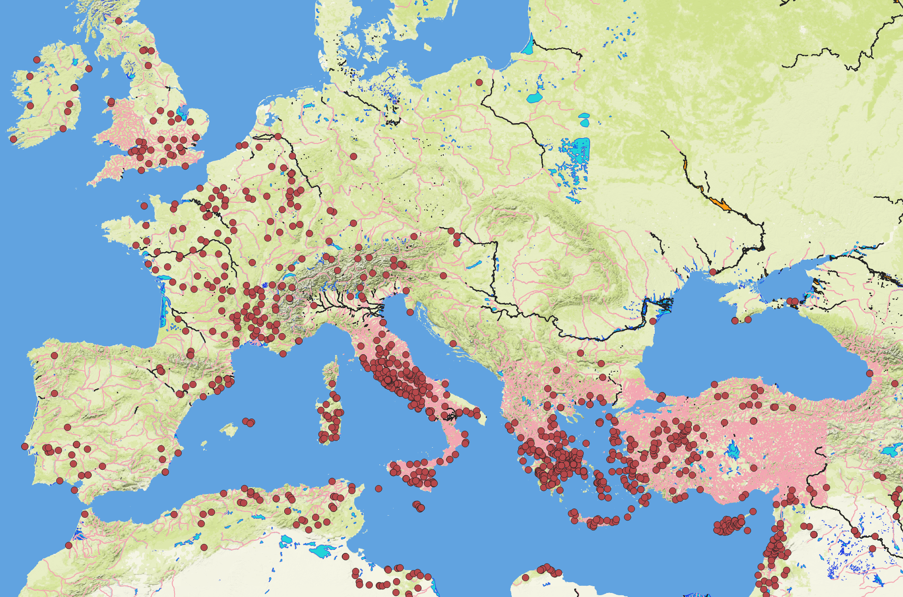
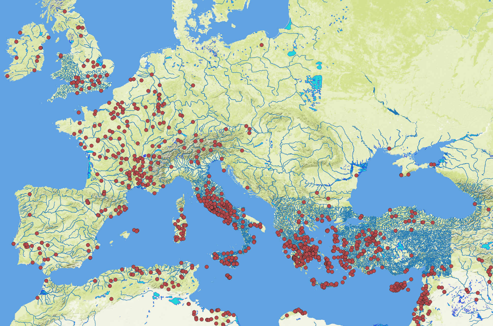
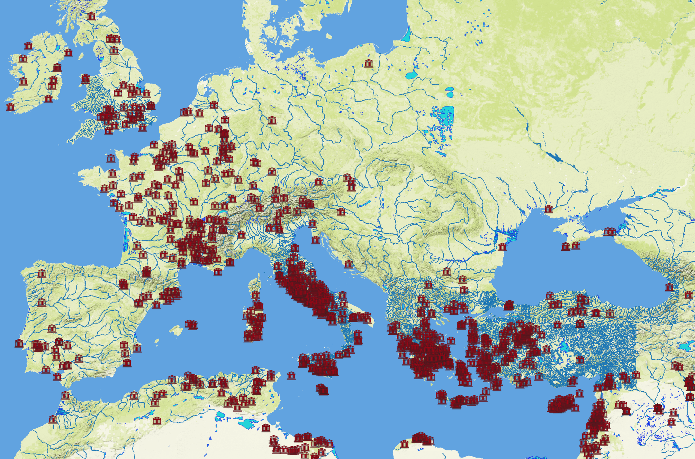
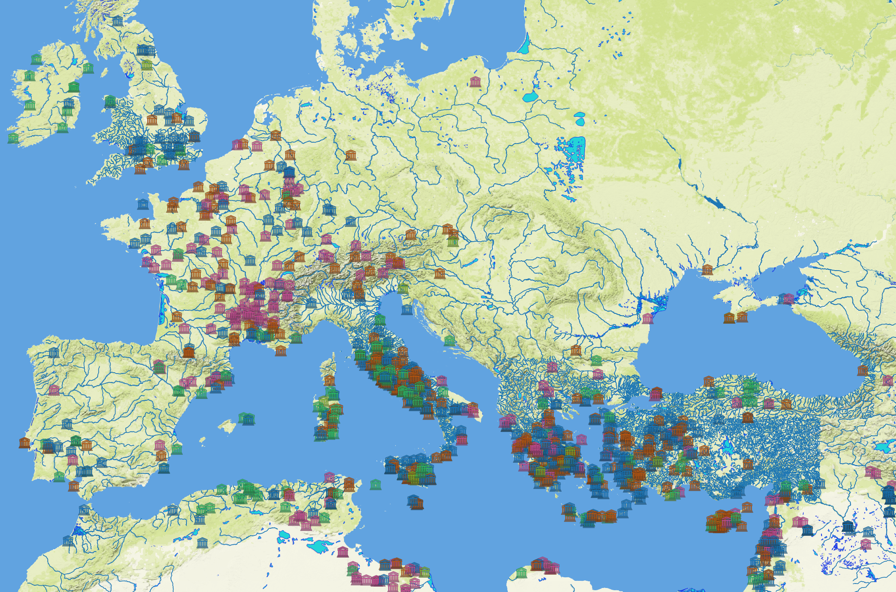
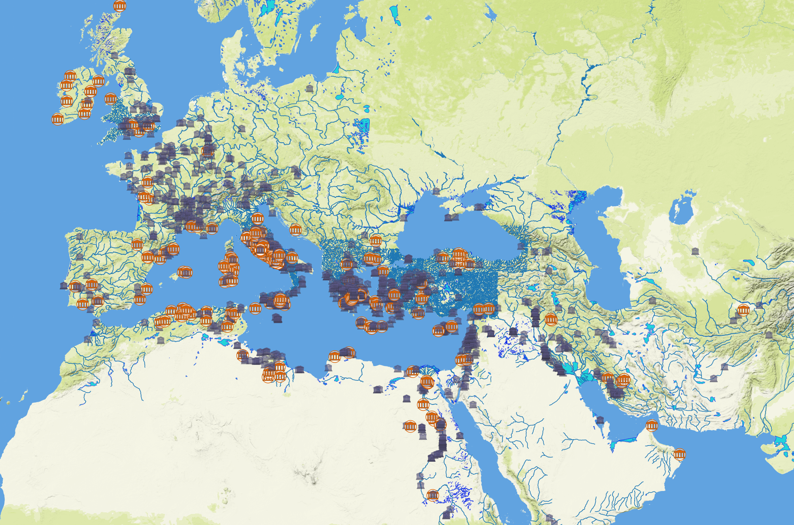
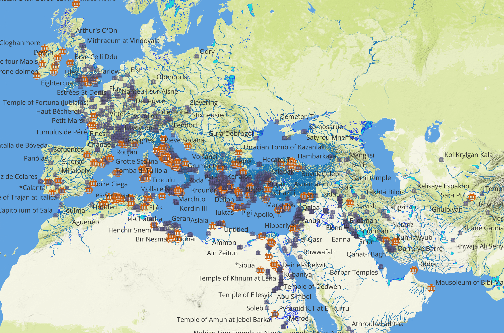
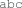
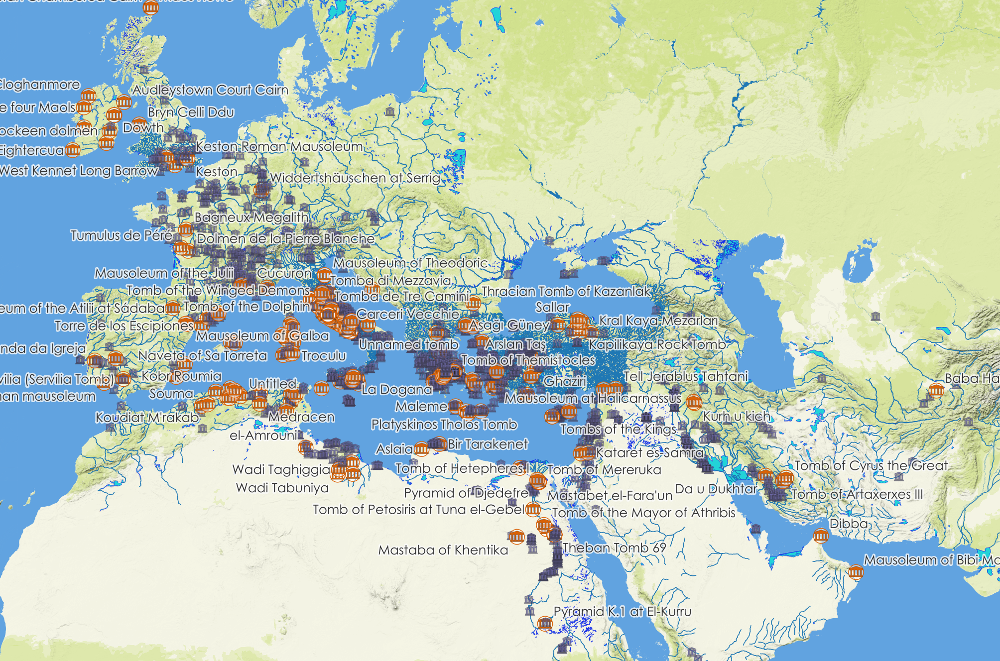

# Symbology, print layout, and aesthetics

## Learning Objectives
In this tutorial, you will learn how to:
- Apply customized colors and styles to features (points, lines, and polygons).
- Add and style labels for features.
- Set an appropriate map projection.
- Design a static map using Print Layout.

## Tutorial

1. Open the project from Tutorial 1, and use Save As to save it as a new file called `tutorial2.qgz`.

    This is actually unnecessary &ndash; you could keep working in your first file &ndash; but while you're learning you should keep your work for each tutorial separate.

### Modifying symbology: colors

Our first step will be to change the appearance of the symbols for points, lines, and polygons from their default colors, since the random browns, greens, oranges, pinks, etc. that QGIS has assigned are not necessarily appropriate for our features.

1. Open the Properties for the inland water layer. (You can do this using right-click and selecting from the context menu, as we did in the last tutorial, or you can simply double-click on the layer name.)

1. Go to 'Symbology' in the left-hand menu.

    Your symbology is currently a simple color fill, specified in the window as **Fill > Simple Fill**, with a **patch** at the left of each showing the color. There are ways to get very complex with this, such as combining multiple patterns and colors, but for the moment, we will just change the colors.

1. Click on 'Simple Fill'.

1. In the 'Symbol layer type' dropdown menu, try clicking on the various different types of fill to see how they change the large patch on the top left and the layers contained within the symbol at the top right. Then return to 'Simple Fill' in the menu.

1. Click on the small dropdown arrow <kbd></kbd> at the right of the 'Fill color' dropdown. You should see a color triangle inside a color wheel, plus various preset color patches.

1. Click again to close the dropdown, then click on the color strip itself. A new window should open up that allows you to choose color by a more nuanced method.

1. Using either method, set the fill color to any light blue. (If you're color blind, then use the second method, and in the 'HTML notation' box, write #33a0d8, which is [the **hexadecimal code**](https://en.wikipedia.org/wiki/Web_colors) for a medium light blue.)

1. If you used the first method, click outside of the color-picker to close the dropdown panel, and if you used the second method, click <kbd>OK</kbd> to close the color-choosing window. Click <kbd>Apply</kbd> at the bottom of the symbology window.

    On your map, you will see that the color of all the bodies of water has now changed to your newly-selected light blue. You don't have to click 'Apply' every time, but you can do so if you want to see how the style looks before closing the window.

1. Click on the 'Fill style' dropdown to see the options. You can use these if you want to use a pattern instead of a solid color, but for now we will leave this as a solid blue.

1. Following the same method as before, change 'Stroke color' to a darker blue. (You can use the hex code #1226ea if you want.) Optionally, click <kbd>Apply</kbd>.

1. Change 'Stroke width' to .13.

1. Click <kbd>OK</kbd> to apply the style and close the Properties window.

    <figure>

    

    <figcaption>
    <b>Open water symbology.</b>
    </figcaption>
    </figure>

1. Change the fill color for river polygons to another blue (you can use #1f78b4 if you want), and this time make a note of the hex code (you can always find out what it is by just hovering over the 'Fill color' color strip, or else by opening the color-choosing window).

1. In the 'Stroke style' dropdown menu, choose 'No Line'.

1. Click <kbd>OK</kbd> to apply the style and close the Properties window.

1. Open the Symbology for the river lines (`awmc-osm-rivers.shp`) and change the Simple Line color to the same color you used for your river polygons, by giving it the same hex code number.

1. Change 'Stroke width' to .2, and click <kbd>OK</kbd>.

    <figure>

    

    <figcaption>
    <b>River symbology.</b>
    </figcaption>
    </figure>

### Modifying symbology: shapes

In the previous part of the tutorial, we customized the fill and outline colors of our polygon and line symbols, and we could do the same for our points.  However, maybe we want points that are more representative of the features they symbolize, rather than simple round circles. We can also customize the shape, if we want.

1. Open the Symbology properties for your religious sites layer.

1. Select Simple Marker in the layer tree at the top of the window, and in the 'Symbol layer type' dropdown, choose 'SVG Marker'.

1. Scroll down in the window until you see the set of icons that you can choose from. For the moment, pick any icon you like &ndash; I will use the 'tourist monument' icon .

1. Scroll back up, and set Width and Height to 4.0 millimeters (you can just change one and the other will change automatically, since currently they are locked together).

1. Change 'Fill color' to a deep red (e.g., #9d0414), and change 'Stroke width' from 'No stroke' to 0.05.

1. Click <kbd>Apply</kbd>; you should see all the markers change to your chosen icon.

    <figure>

    

    <figcaption>
    <b>Custom point symbology.</b>
    </figcaption>
    </figure>

    However, maybe we want to distinguish between our different types of religious site &ndash; remember, we have temples, shrines, sanctuaries, and tombs, and right now we can't visually tell the difference between them.

1. At the very top of the Symbology window, change  Single Symbol to Categorized.

1. In the new 'Value' dropdown menu, choose 'place_type' (you may need to scroll down).

1. Underneath the large empty window, click <kbd>Classify</kbd>.

    The window will fill with different colors of your icon, one for each value of the `place_type` attribute.

1. Untick the box for 'all other values' and click <kbd>Apply</kbd>.

    <figure>

    

    <figcaption>
    <b>Categorized point symbology.</b>
    </figcaption>
    </figure>

    We can already see here what a difference it makes to categorize the features &ndash; some areas have clusters of tombs, others have clusters of temples, and others have very mixed types of religious locations. At the same time, if we read the definitions of temples, sanctuaries, and shrines in the [Pleiades Feature Categories page](https://pleiades.stoa.org/vocabularies/place-types), the difference between them is not necessarily very clear &ndash; it may depend on the perspective of the person who labeled the site. (And, of course, there is no obvious difference between `temple` and `temple-2`.)

    Given this lack of clarity, we want to use one symbol for those various religious sites and a different symbol for tombs. There are various ways to achieve this; we will do the simplest one.

1. In the classification window, select all of the values *except for* 'tomb' and 'all other values' and click . You should be left with only 'tomb' and 'all other values' in the window.

1. Tick the box next to 'all other values'.

    It's kind of hard to make out the tombs amidst all of the other symbols. We'll make it more visible in a few ways.

1. Double-click the symbol next to 'all other values'. In the Symbol Selector window, set Opacity to 90%, set Size to 3mm, and set the marker color to a lavender or purple (e.g., #7570b3). Click <kbd>OK</kbd>.

1. Double-click the empty space under 'Legend' to the right of the text 'all other values' and write **temple, shrine, or sanctuary**. (Caution: don't replace 'all other values' or the icons will disappear.)

1. Double-click the symbol for 'tomb'.

1. Select the SVG Marker and change the Fill color to a dark orange (e.g., #d95f02), and change the marker itself to the 'tourist museum' icon .

1. At the top of the Symbol Selector window, click <kbd></kbd> to add a new layer to the marker.

1. If necessary, use the <kbd></kbd> or <kbd></kbd> arrows to put the new simple marker *below* the SVG marker.

1. Select the new simple marker and make the size 4mm, make the stroke color the same dark orange as your SVG marker, make the fill color white (#ffffff), and make the stroke width 0.2mm.

1. Click the composite Marker at the top of the layer tree and set the opacity to 98%. Click <kbd>OK</kbd>, and click <kbd>OK</kbd> again to set the symbology and close the Properties window.

    <figure>

    

    <figcaption>
    <b>Custom symbology for tombs.</b>
    </figcaption>
    </figure>

    The temples are now much more visible against all the other points for religious sites, and the denser clusters of sites can be observed more clearly as well.

    > [!NOTE]
    > #### Choosing colors
    > Map colors should be chosen both for aesthetics and accessibility. We used blues for the rivers and bodies of water because (of course) water is traditionally depicted in blue. For the sites, however, the important thing is to choose colors that both stand out against the background and are easily distinguished from each other, including for people with various forms of color blindness. While there are many possible shades to choose from, my recommended shades of purple and orange are drawn from [ColorBrewer](https://colorbrewer2.org), a site where one can find sets of contrasting shades that work for colorblindness, black-and-white printing, etc. This is a good site to become familiar with when choosing colors for maps.

### Adding labels

1. Open the Properties for your religious sites layer and go down to Labels in the left-hand menu.

1. In the dropdown menu at the top of the window, change from  No Labels to  Single Labels.

1. In the new Value dropdown menu, choose `title` and click <kbd>Apply</kbd>.

    <figure>

    

    <figcaption>
    <b>Basic labels.</b>
    </figcaption>
    </figure>

    This is a good start, but we just want to label our tombs, and we want to make the labels more legible &ndash; currently only the ones over lighter, uncluttered backgrounds are easy to read.

1. In the top dropdown menu, change to  Rule-based Labeling.

1. There should already be one rule in the list, with the rule '(no filter)' (if not, use the <kbd></kbd> button to add one); select it and click <kbd></kbd> to edit the rule.

1. Give the rule a meaningful description such as 'tombs only'.

1. Make sure that the radio button next to Filter is selected, and type `"place_type" = 'tomb'` into the field. (The double vs. single quotation marks and [lack of] capitalization are all critical to match exactly.) If you want to make sure that you've typed it correctly, you can click <kbd>Test</kbd>; it should return several hundred features.

    > [!INFO]
    >
    > QGIS allows you to build very simple or very complicated expressions in order to select features and attributes for various different tools. If you want to build a more complex expression, you can click the <kbd></kbd> and use the Expression Builder tool, which [you can read about in depth here](https://docs.qgis.org/3.44/en/docs/user_manual/expressions/expression.html).

1. Scroll down in the Edit Rule window, and make sure that 'title' is selected in the Value box.

1. Below the Lorem Ipsum text, make sure that  Text is highlighted in the lefthand menu. To the right of the menu, change the Font to any [sans-serif font](https://en.wikipedia.org/wiki/Sans-serif) that you find appealing (the default is Open Sans; you can leave that if you like).

1. In the lefthand menu, select  Buffer.

1. Tick the 'Draw text buffer' box.

1. Change Size to 0.75mm and Opacity to 80%.

    If you want to see the effect that these changes have, you can change the background color of the Text Sample box by clicking the color bar underneath it and choosing a color other than white.

    We're not going to change the default placement of these labels, but select  Placement in the lefthand menu and look at the various options that are available there, to get a sense of how you might be able to adjust your label placement as needed.

1. Click <kbd>OK</kbd>

1. Click <kbd>OK</kbd> to apply your changes and close the Properties window.

    <figure>

    

    <figcaption>
    <b>Tomb labels.</b>
    </figcaption>
    </figure>

### Setting the projection

1. 

### The print layout

1. 

choose one non-city thing mentioned in Gottesman reading, put it on a map, give it appropriate symbology and a legible label, scale bar, compass, title, legend, use appropriate projection, __other aesthetic things?__