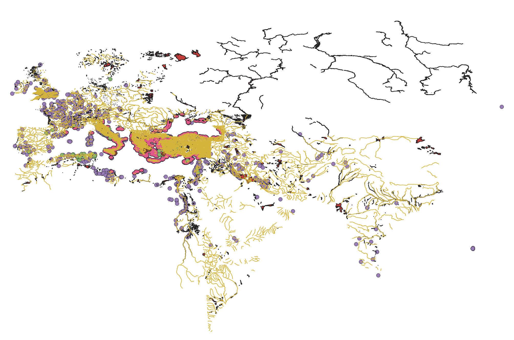
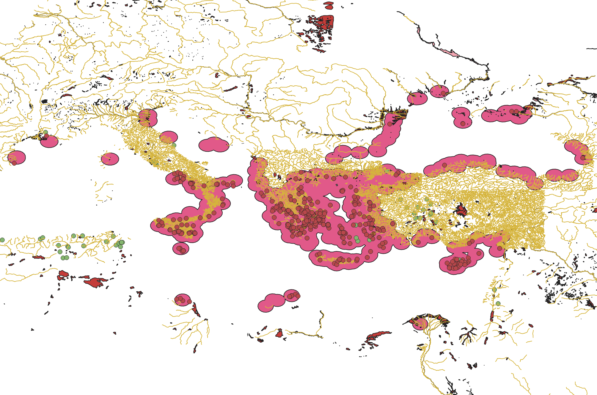
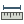
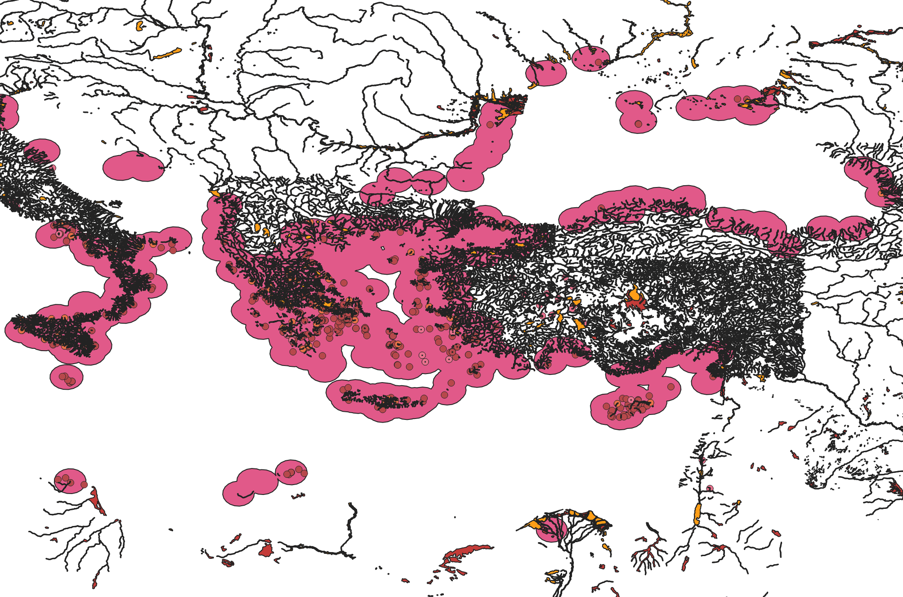

# Refining and extending data

## Learning Objectives
In this tutorial, you will learn how to:
- Clip data to only retain features within a certain region.
- Reproject data to work with tools that require a particular type of projection.
- Buffer features to select a certain area around them.
- Merge data from multiple layers into a single layer.

## Tutorial
Our goal in this tutorial is to find sites of worship in Greece (mainland and colonies) that are near bodies of fresh water (rivers, springs, lakes) or marshy areas.

Start a new project in QGIS and save it in your Tutorials folder as tutorial3.qgz.

### Import files

1. Add the religious sites layer (the only layer in `tutorial_1.gpkg`) that you created in your [first tutorial](./tutorial_1.md).

1. Download [this file of areas within 30 miles of a Greek <i>polis</i>](./data/tutorial_3/poleis_buffer_30mi.geojson) and add it to your project. (Be sure to save it in an appropriate place in your GIS data folder!)

    This file serves a rough approximation of the territory of "ancient Greece," including any colonies from the archaic and classical periods (~750&ndash;323 BCE). It was created using techniques that you will learn in this tutorial, based on data from [POLIS](https://polis.stanford.edu/) and [the Polis Inventory](https://apps.apple.com/us/app/polis-inventory/id1527341314).

1. Add the inland water polygons from AWMC.

1. Download [this file of springs and fountains](./data/tutorial_3/springs.gpkg) and add both layers to your project.

    One layer is derived from the Pleiades places dataset; the other is derived from [ToposText](https://topostext.org/) (another useful site for ancient Mediterranean GIS!).

1. Add the river lines and polygons from AWMC.

    <figure>

    
    <figcaption>
    <b>All the layers added.</b>
    </figcaption>
    </figure>

### Modifying feature layers: clipping

Our first step is to limit the features we're working with to just those in our target area. We do this by **clipping** our target feature layer (the religious sites) based on the polygon layer that marks out our territory of interest.

1. Go to **Processing menu > Toolbox**.

1. In the top search bar of the processing toolbox, type 'clip'.

1. In the results, under 'Vector overlay', choose  Clip. (This can also be found under **Vector menu > Geoprocessing Tools >  Clip...**)

1. In the Clip dialog box, for Input layer select 'tutorial 1 &mdash; religious sites', and for Overlay layer select 'poleis_buffer_30mi'. Leave the other defaults ('[Create temporary layer]' and 'Open output file after running algorithm'). Click <kbd>Run</kbd>.

    You now have a layer called 'Clipped' with just the religious sites that fall within or on the boundaries of the Greek territory.

    **Important: If you close your project, you will lose any layer marked with . If you need to stop working on a project while you have a scratch layer in memory, right-click on the layer, select Make Permanent..., and save it to your computer.**

1. Select your new layer in the Layers panel and open the Attribute Table. (See [Tutorial #1](./tutorial_1.md) if you forget how to do this.)

1. Open 'Filter/Select Features' () and type 'tomb' into the 'place_type' field. At the end of the field, change <kbd>Contains</kbd> to 'Does not contain', and click <kbd> Select Features</kbd>.

1. Export your newly selected features to a geopackage called `tutorial_3.gpkg`, with the layer name 'Greek temples, shrines, sanctuaries'. (See [Tutorial #1](./tutorial_1.md) if you forget how to do this.) Make sure that 'Add saved file to map' is ticked at the bottom of the window before you click OK.

1. Remove the 'Clipped' layer and your original religious sites layer (from tutorial #1) from the map.

    <figure>

    
    <figcaption>
    <b>The newly clipped and filtered layer: temples, shrines, and sanctuaries within Greek territory.</b>
    </figcaption>
    </figure>

### Modifying features layers: reprojecting and buffering

Our next step is to find the regions within half a mile of our freshwater areas.

1. We need to start by selecting only the relevant types of inland water (again, see [Tutorial #1](./tutorial_1.md) if you forget how to do any of the following steps). Create a new layer from the inland water layer that is filtered on the 'TYPE' field as follows:
    - Select: TYPE <kbd>Equals (=)</kbd> lake
    - Add to selection: TYPE <kbd>Contains</kbd> swamp

1. Using the Edit menu, copy the features (it will only take the selected ones) and then 'Paste Features As...' a new scratch layer (called 'lakes and swamps' so that you remember what it is).

1. In the main toolbar, click <kbd></kbd> to clear the selection.

    #### Reprojecting

    Although our next step will be to create a 0.5mi buffer zone around all the freshwater features, this cannot be done in our current CRS: when asking QGIS to do what is, effectively, "distance math," we need to work in an **equal area projection**. We will need to make a new CRS (since there is no existing equal area CRS that spans the entire Mediterranean), and then reproject each of the relevant layers into that CRS.

1. Using [Projection Wizard](https://projectionwizard.org/), mark out an area that goes from Valencia (in Spain) in the west to Tbilisi (in Georgia) in the east, and from the north edge of the Sea of Azov to the southern edge of the Nile delta (around Cairo).

1. Make sure that you have Equal-area selected in the lefthand menu, then copy the WKT string for the Albers equal-area conic projection. Create a custom projection in QGIS (see [Tutorial #2](./tutorial_2.md#setting-the-coordinate-reference-system) if you forget how to do this); give it a name like 'Albers EAC: Greek territory'.

1. In the Processing Toolbox, search for 'reproject' and under Vector general, select 'Reproject layer'.

1. At the bottom of the window, click on <kbd>Run as Batch Process...</kbd>.

1. Using <kbd></kbd>, add four rows to the one already there so that there are five rows total. In the **Input layer** column, set one row each to the following layers:
    - lakes and swamps
    - springs &mdash; tt_springs
    - springs &mdash; pleiades_springs
    - Physical Shapefiles ... awmc-osm-rivers.shp
    - Physical Shapefiles ... rivers_polygons_final.shp

1. In the first row, set **Target CRS** to your newly-created CRS by clicking <kbd></kbd> and selecting your new Albers EAC CRS from ***User-defined*** at the bottom of the list. Use <kbd></kbd> to return to the main window.

1. At the top of the **Target CRS** column, click *Autofill...* and choose Fill Down. All the rows should be populated with your new CRS.

1. At the end of the first row, click on <kbd>...</kbd> and select Create Temporary Layer. Use *Autofill* to fill this choice downward into all the rows.

1. In the Reprojected column, give each layer a name to distinguish it, e.g., 'lakes_etc_reproj', 'tt_springs_reproj', etc.

1. Tick 'Load layers on completion' at the bottom of the parameters window.

1. Click <kbd>Run</kbd>. When the processes all finish running, you can close the window.

    Check your Layers panel &ndash; the five new scratch layers should be there. These are the same as the layers we based them on, but they exist in a different projection and CRS.

    #### Buffering

1. In the Processing Toolbox, search for 'buffer', and under Vector geometry, select  Buffer.

1. Click on <kbd>Run as Batch Process...</kbd>.

1. Make five rows, and set them to each of your new reprojected layers.

1. In the **Distance** column, set the first row to 805 and Autofill it downwards.

    805 represents 805 meters (which is the native unit of the Equal Albers projection), and 805 meters is approximately equal to 1/2 mile. (If we were running this as a single process, we could specify that we wanted to use miles and just put 0.5, but the batch process gives us less flexibility &ndash; it also means we don't have to do this five times in a row.)

1. In the **Dissolve result** column, select Yes in the first row and autofill it downward.

1. At the end of the first row, select Create Temporary Layer and autofill it downward.

1. Give each row a name like 'lakes_etc_buff'.

1. Tick 'Load layers on completion' and click <kbd>Run</kbd>. (The river lines will take a bit longer than the rest to process.)

    You should now have an additional five new polygon layers.

1. Do a reality-check: use the  measuring tool to measure the width of a river line, the margins around a spring or lake, etc. If anything looks off, delete the problematic layers and run the process again.

### Modifying feature layers: merging

When it comes to seeing which temples are within 1/2 mile of water, we only want to compare them to a single layer, not five different layers. This means that we need to merge our new buffered areas into a single layer.

1. In the Processing Toolbox, type 'merge' and under Vector general, select  Merge vector layers.

1. Under Input layers, click <kbd>...</kbd> and select your five new buffered layers. Click <kbd>OK</kbd>.

1. Since we want our output layer to be in the same CRS as our religious sites, under Destination CRS, select Project CRS: EPSG:4326. (If for some reason your project CRS is different, you will need to choose EPSG:4326 from the full CRS list using <kbd></kbd>.)

1. Leave the rest of the defaults selected, and click <kbd>Run</kbd>. You can ignore any alert messages it gives you.

1. Make this new layer (which is labeled as 'Merged' in the Layers panel) permanent by right-clicking and choosing  Make Permanent...

1. Save it to our existing `tutorial_3.gpkg` geopackage, with the layer name 'buffered water sources'. (Note that it will still be called Merged in your Layers panel.)

### Selecting by location

We now want to select all the religious sites that are within 1/2 mile of a water source. Previously we have selected by attribute; now we need to select by location.

1. In the Processing Toolbox, search for 'select' and under Vector selection, choose  Select by location.

1. Under 'Select features from', choose your temples, shrines, and sanctuaries layer.

1. Under 'Where the features (geometric predicate)', select 'are within' and deselect any other boxes.

1. Under 'By comparing to the features from', choose your Merged layer.

1. Leave 'Modify current selection by' as 'creating new selection'.

1. Export the selection as a new layer: save it to your `tutorial_3.gpkg` as a layer called 'religious sites near water'. (See [tutorial #1](./tutorial_1.md) if you forget how to export a selection.)

    <figure>

    
    <figcaption>
    <b>All the scratch and permanent layers.</b>
    </figcaption>
    </figure>

## Submission Instructions

1. Zoom to the extent of your 'religious sites near water' layer. Take a screenshot of your full QGIS window, including the Layers panel.

1. Submit the screenshot and your `tutorial_3.gpkg` file, with its three layers, on CourseWorks.