# Working with elevation data

## Learning Objectives
In this tutorial, you will learn how to:
- Create a virtual raster.
- Apply a color ramp symbology.
- Extract contour lines from an elevation raster.
- Extract a raster footprint.
- Sample data values.

## Tutorial

Our first goal in this tutorial is to display elevation data in two different ways (as a gradient of colors and as [contour lines](https://en.wikipedia.org/wiki/Contour_line)); our second goal is to associate each mountain in the Pleiades dataset with the local elevation and store it as a new attribute of the point feature.

### Adding raster files

Each pixel of a raster contains one single value; the rasters that we are working with today contain elevation data. Other rasters might contain information about land cover (coded as numerical values), population density, etc. Higher-resolution rasters contain finer-grained data, but they take up more disk space.

1. Create a new folder in your GIS folder called `SRTM elevation rasters`.

1. Download the five zip files in [this directory](./data/tutorial_4/) and extract all their contents to your new folder.

    > The extracted files will take up ~1.6GB of space; if you are too low on disk space to extract the files, download [`greece_elev_raster.tif`](./data/tutorial_4/greece_elev_raster.tif) instead, load only it instead of the 66 extracted files, and skip the 'Building a virtual raster' section, although you should still read it to learn the principles.

    These 66 Digital Elevation Model (DEM) raster files come from [USGS EarthExplorer](https://earthexplorer.usgs.gov/). All but one of them are [SRTM 1 arc-second](https://www.usgs.gov/centers/eros/science/usgs-eros-archive-digital-elevation-shuttle-radar-topography-mission-srtm-1) images, covering the area of modern-day Greece and the western coast of Turkey; the final file is created from four [GTOPO30](https://www.usgs.gov/centers/eros/science/usgs-eros-archive-digital-elevation-global-30-arc-second-elevation-gtopo30) files, covering the same area at a lower resolution; it is included because a few areas of the SRTM photos are missing data.

1. In the 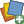 **`Data Source Manger`**, select  **`Raster`**.

1. Click <kbd>...</kbd> and select all the extracted files. Click <kbd>Open</kbd>.

1. Click <kbd>Add</kbd> and wait for the images to load in the background (this may take a while), then close the window.

### Building a virtual raster

1. Go to **`Raster menu > Miscellaneous > Build Virtual Raster`**.

1. Under **`Input layers`**, click <kbd>...</kbd> at the far right.

1. Click <kbd>Select All</kbd>, then click <kbd>OK</kbd>.

1. Under Resolution, choose **`Highest`**.

    This ensures that in all overlapping areas of our two datasets, SRTM and GTOPO30, the highest resolution will be used, and the lower resolution will only be used where the SRTM rasters are missing pixels.

1. Under Virtual, click <kbd>...</kbd> and choose **`Save to File`**; save it to your tutorials folder as `greece_elev.vrt`.

1. Click <kbd>Run</kbd>.

1. Once the virtual raster has been created, remove all the individual rasters from your project, leaving only the new virtual layer.

    <figure>

    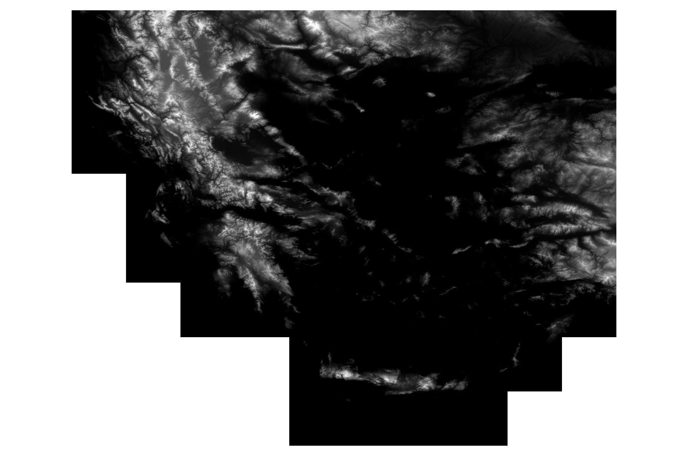

    <figcaption>
    <b>Virtual raster layer joining SRTM files</b>
    </figcaption>
    </figure>

### Applying a color ramp

1. Select the raster layer and open its properties.

1. Under Symbology, change 'Renderer type' from <kbd>Singleband gray</kbd> to <kbd>Singleband pseudocolor</kbd>.

1. Click the bar by 'Color ramp' and choose **`Create New Color Ramp...`**.

1. Select **`Catalog: cpt-city`**. Click <kbd>OK</kbd>.

1. In the lefthand menu, choose 'Top of the (cpt) palettes'.

1. In the righhand window, scroll down to `topo_15lev`. Select it and click <kbd>OK</kbd>.

1. Underneath the window where two values have been loaded, make sure that 'Mode' is set to <kbd>Continuous</kbd>, and click <kbd>Classify</kbd>.

1. Click <kbd>OK</kbd>.

    Everything at or below sea-level is now blue, and the land shades from green through yellow and brown up to white at the highest peaks.

    <figure>

    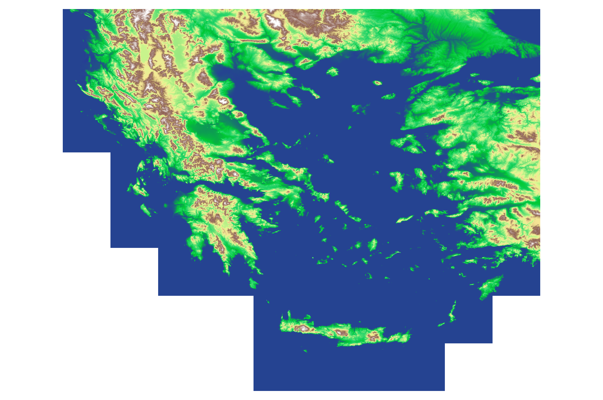

    <figcaption>
    <b>Showing elevation as color.</b>
    </figcaption>
    </figure>

### Creating contour lines

While showing elevation as color is useful on a screen, sometimes it's helpful instead to show elevation as contour lines, which mark out elevation at regularly-spaced levels.

1. Go to **`Raster menu > Extraction > Contour...`**.

1. Set 'Interval between contour lines' to 50 (representing 50 meters, which is what SRTM height is measured in).

    > **Answer this question**
    >
    > Looking at the first few pages of the Buxton reading on mountains, why might I have chosen 50 meters, which is really not a very extensive distance?

1. Leave all the other defaults, and click <kbd>Run</kbd>.

1. The process will take a while, but once it finishes, click <kbd>Close</kbd>.

    <figure>

    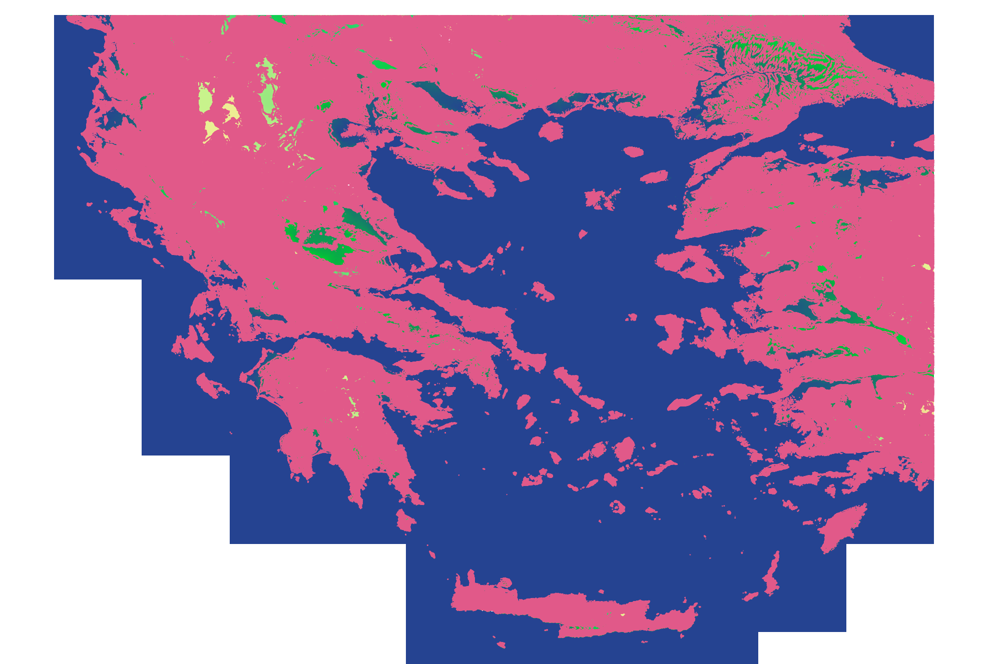

    <figcaption>
    <b>Contour lines added.</b>
    </figcaption>
    </figure>

1. Make the temporary layer permanent: save it in your tutorials directory as a layer called `contours` in a geopackage called `tutorial_4.gpkg`.

1. Remove the contours scratch layer.

### Styling the contour lines

Since we have contour isolines every 50 meters, we want to distinguish more major ones from more minor ones and hopefully make the map a bit more legible. We will have the heaviest lines every 500 meters, mid-weight lines every 250 meters, and fine lines every 50 meters. We also want to visually distinguish any lines at sea-level, which only show up in certain circumstances, such as where there are silting deposits in bays, rather than around the entire coastline.

1. Open the Symbology of the permanent contours layer.

1. At the top of the window, change  Single Symbol to  Rule-based.

1. There should be one rule specified as '(no filter)' &ndash; double-click this.

1. Under Label, write 'major lines (500m)'.

1. Under Filter, write: `"ELEV" % 500 = 0 AND "ELEV" > 0` (make sure the quotation marks are exact). This will select any elevations that are evenly divisible by 500 and are above sea-level (i.e., not 0 elevation).

    > **The modulo (remainder) operator**
    >
    > `%` ("modulo") is a mathematical operator that specifies the *remainder* of a division operation as its result. In the expression `x % y`, if *x* is evenly divisible by *y*, the remainder is zero, so we can use this operator as a method for specifying multiples of a particular number.

1. Set the color to black, and set the width to 0.4mm. Click <kbd>OK</kbd>.

1. Add another rule using .

1. Call this rule 'mid-level lines (250m)', and set it to lines divisible by 250 and above sea-level. Set the color to black and the width to 0.15mm.

1. Add another rule, 'minor lines (50m)', for lines divisible by 50 and above sea level; set the color to black and the width to 0.05mm.

1. Add one more rule, 'sea level', and instead of writing a new rule in Filter, select the radio box labeled 'Else &nbsp; Catch-all for other features'.

1. Set the color to a bright turquoise blue (e.g., `#38fbfb`), and leave the width at the default 0.26mm.

1. Close the Properties/Symbology window.

1. Turn off the visibility of your colorful elevation raster by unticking its checkbox in the Layers panel. If you zoom in, you should see the landscape of Greece covered with finer and thicker lines, and bits of the coastline marked out in turquoise.

    <figure>

    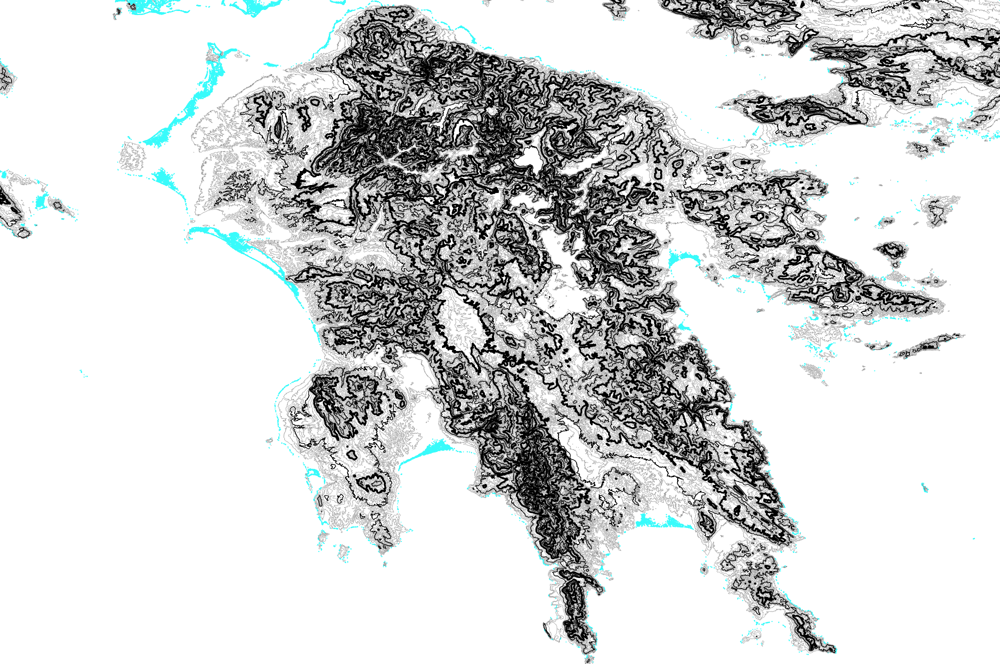

    <figcaption>
    <b>Differentiated contour lines.</b>
    </figcaption>
    </figure>

### Make a static map of elevation

1. Create a new print layout (see [Tutorial #2: The print layout](./tutorial_2.md#the-print-layout) if you forget how to do this).

1. Add a large map box, and set its CRS to **Greek Grid (EPSG:2100)** (see [Tutorial #2: Map boxes](./tutorial_2.md#map-boxes)).

    Notice the big difference in the shape of the region between EPSG:4326 and EPSG:2100!

1. Zoom the contents and resize the box until you have your full set of contour lines visible and filling most of the page vertically. Move it all the way to the right side of the page.

1. In the map box's Item Properties tab, Scroll down to Layers and tick the box next to 'Lock layers'. (If the only difference between map boxes is layer visibility, this is much simpler than creating a new map theme.)

1. Go back to the main project and turn off the contour layers and turn on the colored elevation layer.

1. In the layout, create a second, smaller map box that fills the leftover space on the left side of the page.

1. Again, set its CRS to Greek Grid, and resize it so that it's as large as possible while not covering any of the contour lines map.

1. Lock the layers for this map box, too.

1. Add two legends, drawing one over each map box. (The legend automatically links to whichever box it's drawn over.)

1. In the Item Properties for each legend, under Legend Items, untick the 'Auto update' box and tick the box next to 'Only show items inside linked maps'.

    Using "only show items inside linked maps" is likewise a simpler method of limiting the items in the legend, but sometimes it has unintended consequences, which is why we did not take this approach in our first layout tutorial.

1. In the list of items for each legend, right-click the relevant layer and select 'Hidden' to remove the layer name.

1. If the color ramp bar is too short on your map, double-click the bar in the legend's list of items and change the height from 'Default' to whatever size looks appropriate (e.g., 20&ndash;25mm).

1. Double-click "Band 1 (Gray)" in the list of items and change the text to "Elev. (m)" or "meters", so a viewer can see what the units are.

1. Add a scale bar for each map, and add a north arrow. Add a title "Elevation of Greece", and add a credit line with your name and the data source (which is "USGS (SRTM and GTOPO30)").

1. You can customize fonts, backgrounds, borders, etc. for all these components as you prefer.

    <figure>

    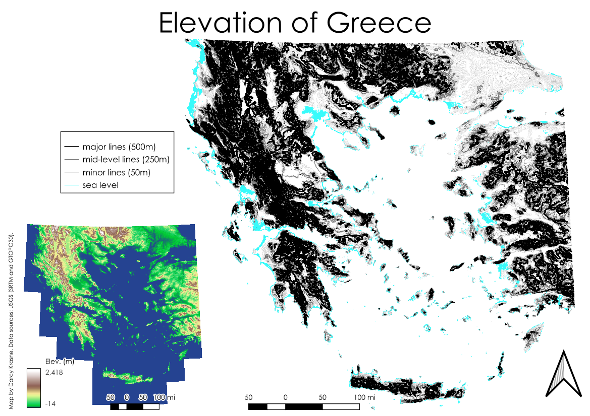

    <figcaption>
    <b>An example of how the layout might look.</b>
    </figcaption>
    </figure>

    Note that the contour lines are mostly not distinguishable in the mountainous regions: if we were making this map to actually convey information, rather than practice techniques, we would want to show smaller regions of the map to improve the visibility of the lines.

1. Export a PDF of your layout.

### Extracting Greek mountains

1. In your QGIS project, add the Pleiades `places.csv` and `places_place_types.csv`.

    Instead of connecting them immediately with a join through Properties, we're going to use a different joining method to make sure that we get *all* the mountains &ndash; remember that some features have more than one associated place type.

1. In the Processing Toolbox, search for 'join'. Under Vector general, choose **`Join attributes by field value`**.

1. Make sure that the selected Input layer is `places`, and choose `places_place_types` for Input layer 2.

1. For Table field, choose `id`, and for Table field 2, choose `place_id`.

1. Under Join type, choose 'Create separate feature for each matching feature (one-to-many)'.

1. Click <kbd>Run</kbd>. When the process is finished, close the window.

    We now have a layer with over 10,000 more points than the original Pleiades layer &ndash; any feature that has more than one associated place type has been duplicated.

1. Open the attribute table of the new layer ('Joined layer').

1. Select all features with the place type 'mountain' (see [Tutorial #1](./tutorial_1.md#filtering-data) for a reminder of how to select specific features).

1. Using the Edit menu, copy the selected features and paste them as a new scratch layer called 'mountains' (see [Tutorial #3](./tutorial_3.md)).

    <figure>

    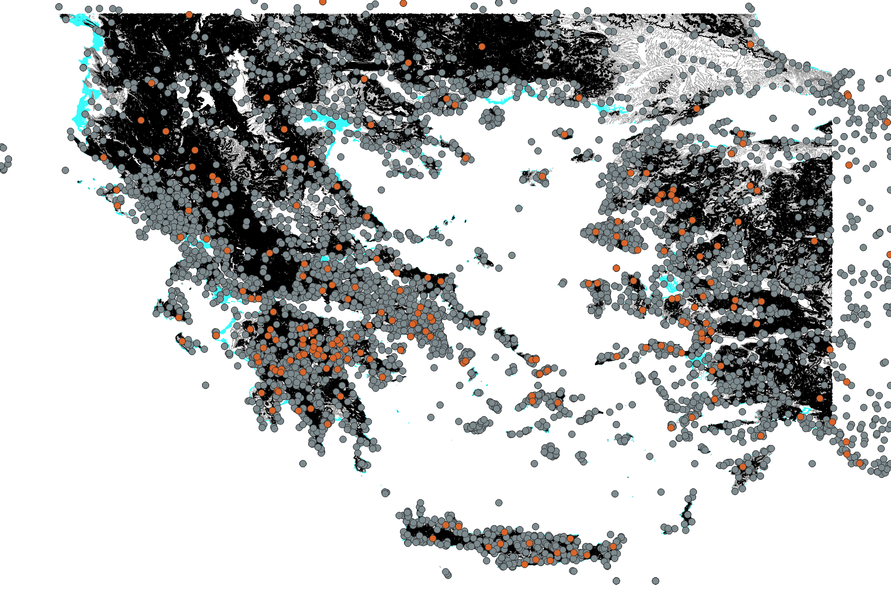

    <figcaption>
    <b>Mountains as a separate layer.</b>
    </figcaption>
    </figure>

    We currently have all the mountains in the dataset, but we only want mountains that fall within the same zone as our elevation layer. Since the Clip tool only allows us to clip a vector layer based on another vector layer, we need a vector that is the same shape as our raster. We therefore will extract the raster's footprint as a vector.

1. In the Processing Toolbox, type 'extract extent' in the search bar. Under Layer tools, choose 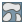 **`Extract layer extent`**.

1. For Input layer, choose your `greece_elev` raster. Leave the other defaults and click <kbd>Run</kbd>. When the process is finished, close the window.

1. Clip the mountains layer by your new Extent layer (see [Tutorial #3](./tutorial_3.md#modifying-feature-layers-clipping) for a reminder).

    <figure>

    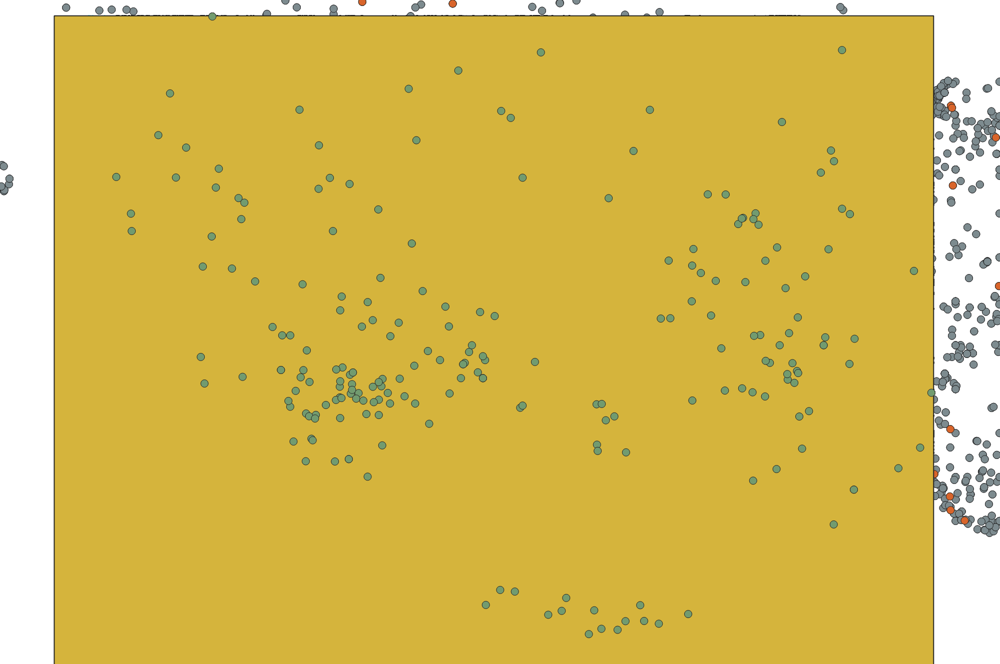

    <figcaption>
    <b>Greek mountains and the raster bounding box.</b>
    </figcaption>
    </figure>

1. You can now turn off or delete your extent layer.

### Sampling raster data: Adding an elevation attribute

1. In the Processing Toolbox, type 'sample'. Under Raster analysis, choose **`Sample raster values`**.

1. For Input layer, choose `Clipped` (which is your layer of mountains within the bounds of the raster), and for Raster layer, choose `greece_elev`.

1. Change the Output column prefix to `ELEV_`.

1. Click <kbd>Run</kbd>. Once the process is finished, close the window.

1. Open the attribute table of the new Sampled layer. If only one feature is shown, rather than the table of features, click <kbd></kbd> in the lower right corner of the attribute table.

1. Your new elevation attribute is the last column. Sort the table by elevation by clicking on the the header `ELEV_1`.

    The lowest elevation is... zero. **[Note: This is true as of November 2026; if this gets changed, the tutorial will be updated.]** Let's investigate this.

1. Right-click on one of the rows with a zero elevation and choose **`Zoom to Feature`**. Click on the row number to select the row, so it turns bright yellow on your map.

    The mountain is apparently located in the ocean, which seems implausible. However, if we look at the `location_precision` column, notice that for most of the zero-elevation features, the value of precision is 'rough', by contrast with some other features with the precision 'precise'. **Not all Pleiades locations are certain, and even those that are labeled precise aren't always exact.** (For example, even long mountain ranges are represented as a single point, which can't capture the entirety of the range.)

    Of the other low-elevation mountains, several have a rough location precision, but a few are labeled 'precise'. Let's look at Mount Kynthos, a very famous mountain in mythology (it's the origin of Apollo and Artemis's epithets Kynthios and Kynthia), which is recorded as having a precise location but is listed as only 99 meters.

1. Zoom to Mount Kynthos and select the row.

    It turns out that it's located on a very small island (Delos, the birthplace of Apollo and Artemis). According to Wikipedia, Mount Kynthos has an elevation of 113 meters, which means that our sampled elevation of 99 meters is very close to accurate.

    Let's look at the highest mountains.

1. Scroll to the other end of the table (or just click the header again to sort in a descending order).

    Our tallest-listed mountain is Mount Olympus. Since Olympus is known to be the highest peak in Greece (that's why it's the home of the gods!), this seems accurate. Wikipedia lists the elevation of its highest peak at 2,917.7 meters, so our sampled 2,774 meters (as of November 2026) is again relatively accurate.

### More with rasters: getting statistics

Can we find more accurate or more plausible high-point elevations for our mountains, even the roughly-located ones? We can try, although these will still be estimates. In order to do this, we're going to create a buffer around each mountain and find the maximum value of the elevation raster layer within each buffer.

1. Reproject your `Sampled` layer to Greek Grid EPSG:2100 (see [Tutorial #3](./tutorial_3.md#reprojecting) if you forget how to do this).

    Remember, we want to use a conformal CRS for buffering, and Greek Grid is a conformal CRS that is exactly accurate for the shape of Greece, which is precisely what we want in this context.

1. Open the Buffer tool and make sure that your new `Reprojected` layer is selected as the Input layer.

    Instead of setting one buffer distance for all our points, like we did last time, we're going to set one buffer for our 'rough' locations and a different buffer for our 'precise' locations.

1. Click  at the right of the Distance field, and select **`Edit`** from the dropdown menu.

1. In the Expression box, write: `IF("location_precision"='rough', 5000, 2000)`

    This expression says that if a feature has its `location_precision` as 'rough', it should be given a 5km (5,000m) buffer radius, and otherwise (i.e., if it's precise), it should be given a 2km radius.

1. Click <kbd>OK</kbd>, and then click <kbd>Run</kbd>. When the process finishes, you can close the window.

    <figure>

    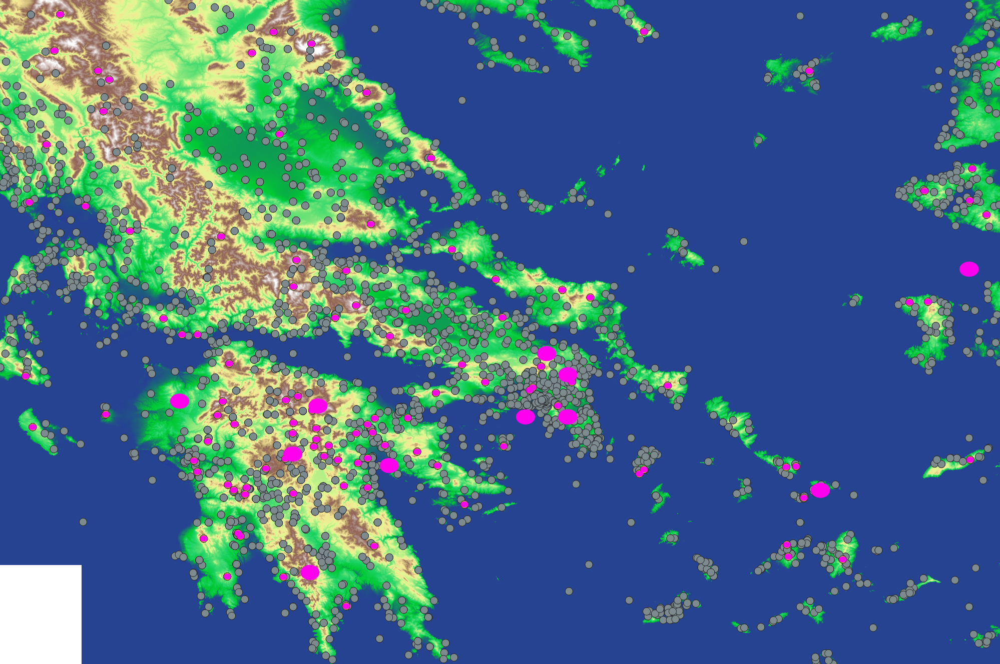

    <figcaption>
    <b>Variably-sized buffers.</b>
    </figcaption>
    </figure>

1. In the Processing Toolbox, type 'zonal' and under Raster analysis, select **`Zonal statistics`**.

1. For the Input layer, choose `Buffered`, for Raster layer, choose `greece_elev`, and for the Output column prefix, type `elev_`.

1. Click <kbd>...</kbd> next to the Statistics to calculate field, and select only Maximum. Click <kbd>OK</kbd>.

1. Run the process and close the window.

    If we inspect the attribute table for our new `Zonal Statistics` layer, we'll see that some of the zero-elevation mountains have been given elevations, and that Mount Olympus now has an elevation even closer to its recorded high point.

    Some elevations have changed only minimally, while others have changed by several hundred meters: these are not necessarily more accurate, but some of them are. It's a useful contrast.

    Now we need to attach these values to our mountain points layer. There are several ways to do this, but the best method is to join our polygon layer to one of our several mountain point layers and add the new `elev_max` attribute to the features of that layer.

1. Deselect the box next to your 'Joined layer' layer, just so that you don't get confused between the layer when you create another joined layer (which will have the same name) &ndash; or you could also just remove this layer, as we don't need it anymore.

1. Search in the Processing Toolbox for 'join' and under Vector general, select **`Join attributes by field value`**.

1. For Input layer, select 'Sampled' &ndash; this layer is limited to mountains within our raster boundary, and it already includes the original `ELEV_1` elevation attribute. (We could also used 'Clipped', but then we would need to add both elevation attributes.)

1. For Table field, choose `place_id`.

1. For Input layer 2, select 'Zonal Statistics', and again choose `place_id` as your Table field 2. We are joining the same Pleiades ID to the same Pleiades ID.

1. Under Layer 2 fields to select, click <kbd>...</kbd>, and select only `elev_max` (or if you're using 'Clipped' as your first input layer, also select `ELEV_1`). Click <kbd>OK</kbd>.

1. Since we should only have one feature per ID, leave Join type as the default one-to-one join.

1. Click <kbd>Run</kbd> and close the window when the process is finished.

    If you open the attribute table for your new layer (the 'Joined layer' that is still selected), you will see that it contains both elevation columns.

1. Make your new layer permanent by saving it to your `tutorial_4.gpkg` as a layer called 'mountains with elevations'.

### Showing elevation as symbology

We now want to visually show the height of our mountains: taller mountains should be larger, and shorter ones should be smaller. We will use a new method of symbolizing the points to do this.

1. We don't need any more of our scratch layers, so remove them all from the map, as well as the 'places' and 'places_place_types' layers. You should still have your elevation raster, your contours layer, and your new Joined layer of Greek mountains (remember, making it permanent doesn't change the name in the Layer panel; you can rename it in the Layer panel if you want to).

1. Open the mountain points layer Properties.

1. Under Symbology, choose 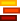 Graduated at the top of the window.

1. Under Value, choose **either** `ELEV_1` **or** `max_elev` from the dropdown menu, depending on which you decide you want to use.

1. Under Symbol, click the marker, and set Opacity to 80%.

1. Select the Simple Marker layer, then scroll down in the window and choose a triangle from the available set of default shapes. (You can either leave the default color or pick a different color.) Click <kbd>OK</kbd>.

1. Under Method, choose Size. (For now, leave the default range of sizes.)

1. Leaving the Mode at the default ('Equal Count (Quantile)'), click <kbd>Classify</kbd>, then click <kbd>Apply</kbd>.

    <figure>

    

    <figcaption>
    <b>Mountains sized by 5 quantiles.</b>
    </figcaption>
    </figure>

    There are some advantages to this method of classification, such as that it includes one group of mountains that are "average" (i.e., [median](https://en.wikipedia.org/wiki/Median)) size, and all the groups have equal numbers of mountains in them, but maybe this doesn't make sense for our data. Maybe we want to see other types of clusters, and maybe we want to single out especially tall or especially small mountains as their own groups.

    Let's look at the data.

1. Click on the tab next to <kbd>Classes</kbd> that says <kbd>Histogram</kbd>.

1. Click <kbd>Load Values</kbd>.

    What the histogram shows is the number of mountains that falls into each range of data, divided equally into a certain number of bins. Currently there are 30 such bins (i.e., dividing the extant range of mountain elevations into 30 equal portions).
    
    If you make the number of bins smaller (e.g., 15), there will be fewer groups, meaning a coarser division of the data, and if you make the number of bins larger (e.g., 50), there will be more groups, meaning a finer division of the data.

    Regardless of whether you're using `elev_max` or `ELEV_1` as your size value, we can see that there are more mountains humped over toward the left side of the chart (shorter mountains of more similar elevations) and then a longer tail stretching off to the right (taller mountains over a wider range of elevations).

    The vertical lines on the histogram show us the values currently being used to separate groups of mountain elevations.

    Rather than assigning equal number of mountains to each size category, it might make sense to have the data grouped by more similar sizes.

1. Return to the <kbd>Classes</kbd> tab.

1. Change 'Equal Count (Quantile)' to 'Natural Breaks (Jenks)', and click <kbd>Classify</kbd>. (The classification will likely have already changed when you changed the method, but it's good to double-check.)

    Natural Breaks will find the specified number of "groups" in the data, based on how the mountain elevations cluster together &ndash; there is no guarantee that there will be a similar number of mountains in each group, nor a guarantee that the ranges assigned to each group will be similar. There's also no "correct" number of groups, but it's hard for the human eye to tell apart more than about 5 or 6. We'll leave the number of divisions at the default value of five, although we're going to add one more group manually.

1. Change the low value of 'Size from' to 2mm, and make the largest 9mm.

1. Click  to add a class manually.

1. Double-click the Values (0.00 - 0.00) for this new class and set the Upper value to 100. Double-click the Legend for this new class and adjust it so that it reads `0 - 100`. Double-click the symbol for this new class and set the size to 1mm.

1. Click <kbd>OK</kbd> to set the symbology and close the window.

    <figure>

    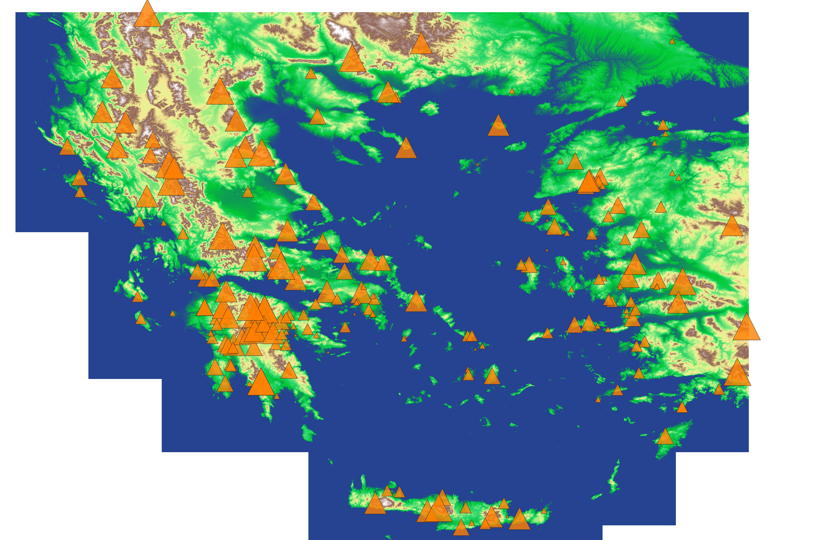

    <figcaption>
    <b>Mountains sized by natural breaks.</b>
    </figcaption>
    </figure>

## Submission Instructions

1. Right-click on the mountains layer in the Layers panel, and zoom to the layer extent. Take a screenshot of your full QGIS window, including the Layers panel. (You can have either or both of your elevation layers turned on.)

1. On CourseWorks, submit your screenshot, the PDF of your elevations layout, and your `tutorial_4.gpkg` with its two layers ('contours' and 'mountains with elevations').