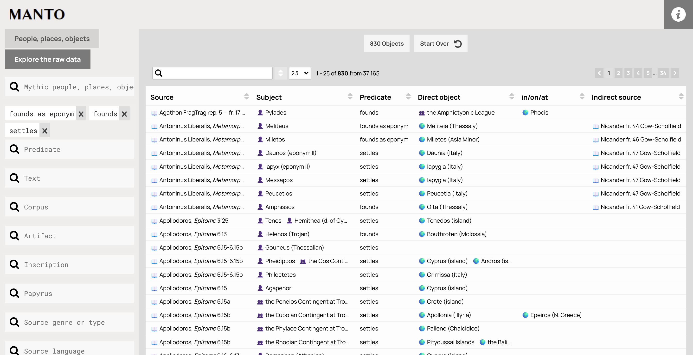
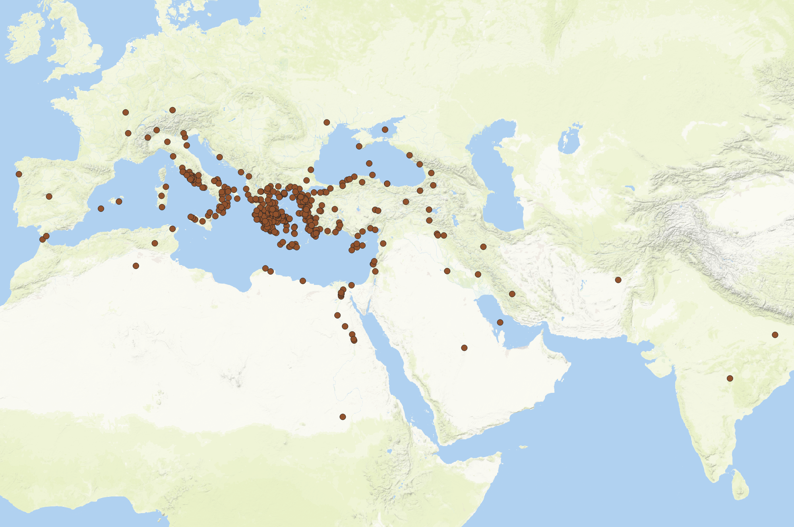
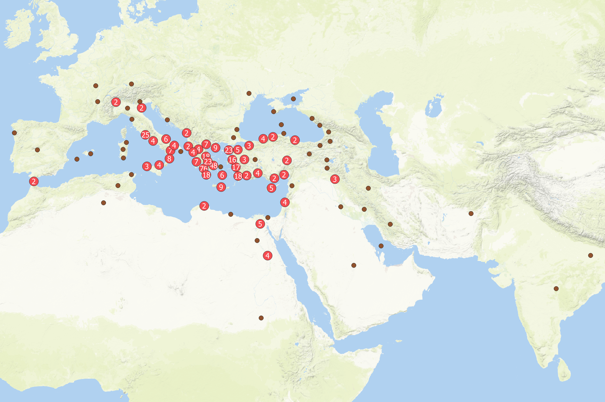
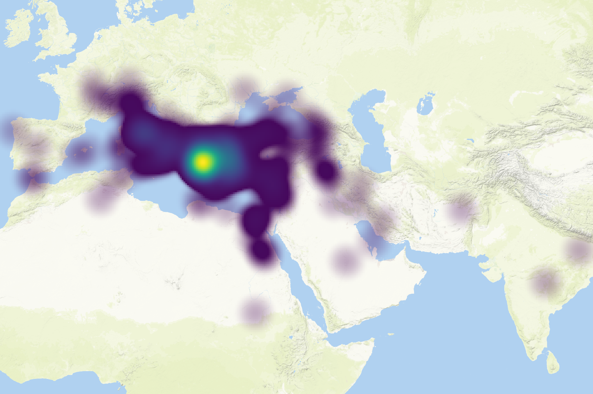
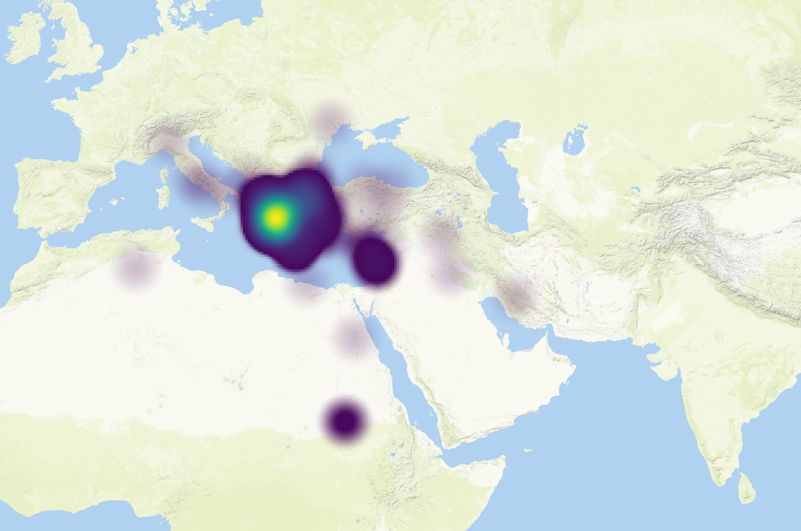
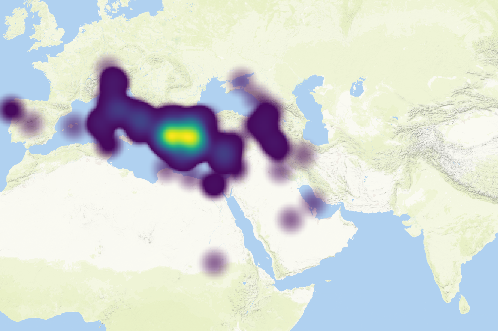
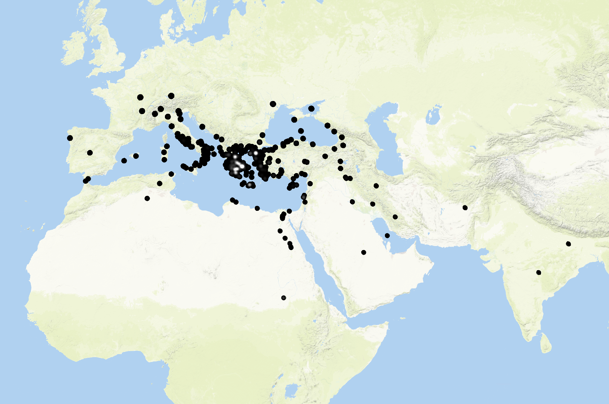

# Sizing/clustering and binning points

## Learning Objectives
In this tutorial, you will learn how to:
- Visualize dense points as scale-dependent numbered clusters.
- Visualize points as a scale-dependent heatmap.
- Create a kernel density estimation (KDE) heatmap.
- Bin points using a grid.

## Tutorial

Our goal in this tutorial is to discover where in the ancient world was seen as a common destination for foundations and settlements, within myth, and which cities or regions were seen as the origin for such colonizing ventures and diasporas. We will be working with data derived from [MANTO](https://manto.unh.edu/), using the three ties `founds`, `founds as eponym`, and `settles` ([click here to explore the most recent version of that data in MANTO](https://manto.unh.edu/viewer.p/60/2800/filter/6582_OD_17807_6583-OR:6583-11302904|6583-8188784|6583-8188790/list/)).

<figure>

<figcaption>
<b>Ties in MANTO</b>
</figcaption>
</figure>

### Exploring the data

1. Add the CAWM basemap (see [Tutorial #1](./tutorial_1.md#adding-a-basemap) if you forget how to do this).

1. In the Layers panel, open the basemap properties.

    We're only using the basemap to give us a sense of where our points are, once we add them, but we don't want it to stand out too strongly. So we're going to reduce its visibility.

1. In the properties, go to Transparency in the lefthand menu.

1. Set Global Opacity to 50%. Click <kbd>OK</kbd>.

1. Download [`myth_foundations.geojson`](./data/tutorial_5/myth_foundations.geojson) to your GIS folder and add it to your project.

1. Zoom to the extent of the points layer.

    <figure>

    

    <figcaption>
    <b>Origins and foundations</b>
    </figcaption>
    </figure>

    We can see that there are points ranging from Spain in the west to India in the east, and from northern Europe south to the Nile. These include the origins of founders, the destinations of founders, and places mentioned as being "near" an origin or destination.

1. Open the attribute table for your points layer.

    The first part of the attributes table should look familiar: this data is drawn from Pleiades. The last six columns, however, are new. They are to be interpreted as follows:

    |attribute|definition|
    |:---:|:---|
    |`num_col_ties`|The number of unique ties existing in MANTO that mention this location as the origin for a colonizing expedition or other diasporic event.|
    |`num_colonies`|The number of distinct locations specified in MANTO as being founded as part of an expedition/diaspora that originates at this location.|
    |`num_orig_ties`|The number of unique ties existing in MANTO that mention this location as the destination of a colonizing expedition or other diasporic event.|
    |`num_origins`|The number of distinct locations specified in MANTO as the origin for an expedition/diaspora that ends at this location.|
    |`is_founded`|A boolean (true/false) signifying that there is at least one mythic narrative about the foundation of this location.|
    |`is_origin`|A boolean (true/false) signifying that there is at least one mythic narrative about a colonizing expedition or other diasporic event originating at this location.|

    We won't be working with all of this data, which is often the case when using existing datasets. However, it's important to understand what each attribute records, information that can be found in the accompanying **data dictionary** (in this case, the dictionary is provided above).

    Close the attribute table.

### Visualizing density

1. Open the layer properties.

1. Under Symbology, change Single Symbol to  Point Cluster. Click <kbd>OK</kbd>.

    <figure>

    

    <figcaption>
    <b>Point clusters symbology</b>
    </figcaption>
    </figure>

    This enables us to see *how many* points there are wherever the points are densely clustered. This can be useful for decluttering the map, at small scales, and for seeing where we might need to view the map at a larger scale because that region contains a high number of closely-set features.

1. Zoom in to Greece. Notice that the numbers and clusters change as the scale changes.

1. Open the layer's symbology again, and select  Heatmap instead of Point Cluster.

1. Click on the dropdown arrow next to the Color ramp bar, and choose **`Viridis`**. Click <kbd>Apply</kbd> to see how it looks without closing the dialog.

    The entire map is now covered with dark blue, with a few exceptions, because there are zero points in most areas of the map. Let's solve this problem.

1. Click on the color ramp itself.

1. In the new dialog box, click on the farthest-left gradient stop (the triangle-tipped squares under the gradient).

1. Change Opacity to 0% and click <kbd>OK</kbd>.

1. Click <kbd>OK</kbd> to set the symbology and close the dialog box.

    <figure>

    

    <figcaption>
    <b>Heatmap symbology</b>
    </figcaption>
    </figure>

1. Zoom in and out of the map. Notice how the density displayed by the heatmap changes, just as the numbers in the cluster marks changed.

### Weighting density

Both of these visualizations are useful methods for looking quickly at the density of locations in a map. However, in this case, what we want is to find information about colonization in myth, not just see where the points themselves are the most dense.

1. Open the layer symbology again. Under **`Weight points by`**, choose `num_colonies`. Click <kbd>OK</kbd>.

    <figure>

    

    <figcaption>
    <b>Heatmap symbology, weighted by number of colonies</b>
    </figcaption>
    </figure>

    Now we have much more useful diagnostic information: we can see that, predictably, the bulk of colonizations start *in* Greece.

1. Open the layer symbology again, and this time weight your points by `num_origins`.

    <figure>

    

    <figcaption>
    <b>Heatmap symbology, weighted by number of origins</b>
    </figcaption>
    </figure>

    While Greece still receives the most attention within myth as the endpoint of ktistic (i.e., foundational) narratives, it's also clear that mythology wants to explain the Greek origins of locations expanding outwards, especially to the west and east.

    > **Interpreting the map**
    >
    > It's important to understand precisely what this second map shows and does not show. What it does *not* show is the unweighted density of places that laid claim to *at least* one colonizing narrative. Instead, it shows the total density of *all* colonizing narratives, so a place that was refounded on a number of occasions, or that has competing narratives about its origin, will show up more brightly than a place that just has a single consistent narrative.
    >
    > What this means is that we can't tell from this map which regions are hotspots for the founding of multiple towns and cities and which regions are hotspots for competing narratives.

### Generating a heatmap

The symbology approach that we took above is great for looking quickly at things. But as we zoom in and out, the density changes, and we have no control over what QGIS is considering to be a "cluster": how near does something have to be to something else for it to be "nearby"? Depending what we're looking at, our answers to these questions will change.

1. Return the layer to Single Symbol symbology.

1. In the Processing Toolbox, search for the **`Reproject layer`** tool, and use it to reproject the `myth_foundations` layer from its current CRS (EPSG:4326) to **EPSG:3035 - ETRS89-extended / LAEA Europe** as the target CRS. (If you forget how to choose a CRS and reproject a layer, see [Tutorial #3](tutorial_3.md#modifying-features-layers-reprojecting-and-buffering); here we're only reprojecting one layer, so don't use the Batch Process option.)

    In order to run processes that depend on the density of points, which is what we will be doing in the rest of this tutorial, we need our layer to be in an Equal Area CRS. [EPSG:3035](https://epsg.io/3035) is an Equal Area CRS that is accurate for an east-west span of all of Europe, through to halfway across the Black Sea, so it encompasses most of our points.

1. In the Processing Toolbox, search for 'heatmap'. Select **`Heatmap (Kernel Density Estimation)`**.

1. For Point layer, choose your new 'Reprojected' layer.

1. Set Radius to 45000 meters (or 45km, if you change the units in the dropdown to kilometers). This gives us a happy balance between, e.g., all of Greece counting as "near" to each other and every city and town having no neighbors.

1. Set Pixel size X to 1000 (Pixel size Y will change automatically). This represents 1000m (the unit of the layer's CRS).

1. Under Advanced Parameters, set Weight from field to `num_colonies`.

1. Click <kbd>Run</kbd>, and when the process is finished, close the window.

    <figure>

    

    <figcaption>
    <b>Kernel Density Estimation heatmap, weighted by number of colonies, shown in greyscale</b>
    </figcaption>
    </figure>

    This is a good start, but every location in the point layer has a circle around it. We want to remove the ones that have zero colonies, as well as changing the colors to something more legible than black and white.

1. Open the Properties for your new Heatmap layer. (If you're prompted to select a transformation again, click <kbd>OK</kbd>.)

    Notice that this newly-generated heatmap is a raster!

1. First, go to Transparency, and change the Global Opacity to 90%. (That way, we'll be able to make out the actual map behind our heatmap.)

1. Set Additional NoData value to 0. Click <kbd>Apply</kbd>. Behind the window, you should see most of the farthest-flung black circles disappear!

1. Still in Settings, go to Symbology, and change the Render type to Singleband pseudocolor. For Color ramp, choose Viridis.

1. Click on the color ramp, and set the leftmost gradient stop to 0% opacity. Set the second stop to 50%, and the third stop to 75%. Click <kbd>OK</kbd>.

    Now we can see with more clarity which of the remaining circles outside of the main cluster have only one colony (these are highly transparent), which have a somewhat higher but still small number of colonies (these are more solid but still dark blue), and which have a much higher number.

1. Export your temporary heatmap raster as a GeoTIFF called `kde_origins.tif`, in your tutorials folder.

    Notice that it has been added to the map with black-and-white symbology &ndash; we can easily apply the modified symbology from the temporary layer.

1. Right-click your 'Heatmap' layer, scroll down in the context menu to **`Styles`**, select **`Copy Style`** in the sub-menu, and click on **`All Style Categories`**.

1. Right-click on your new kde_origins layer, and click on **`Styles > Paste Style > All Style Categories`**.

1. Delete the 'Heatmap' and 'Reprojected' scratch layers from your project.

### Foundation locations vs. stories

We're now going to attempt to solve <a href="#interpretation">the problem indicated above</a> concerning what the heatmap does or does not show with regards to our founded locations.

1. Using the data filter in the attribute table, select only locations that have a value for the `num_origins` attribute that is **greater than or equal to 1**. (If you don't remember how to select locations using the data filter, see [Tutorial #1](./tutorial_1.md#filtering-data).)

1. Copy the selected features and paste them as a scratch layer called 'foundation locations' (see [Tutorial #3](./tutorial_3.md#modifying-features-layers-reprojecting-and-buffering)).

    We now have a layer showing only locations that have at least one narrative stating that they were founded by someone who started out in another location.

1. Reproject this new layer to EPSG:3035.

1. Generate a KDE heatmap from the 'Reprojected' layer with the same radius and pixel size as before, but leave 'Weight from field' blank.

1. **Without closing the window**, go back to the <kbd>Parameters</kbd> tab, select `num_origins` in 'Weight from field', and run the process to generate a second heatmap. (If you accidentally closed the window before this step, you'll need to set the radius and pixel size again.)

1. Close the window.

1. Export the first raster as a GeoTIFF called `kde_foundation_locations.tif` and the second raster as a GeoTIFF called `kde_foundations_weighted.tif`. (If you're not sure which raster is which, the first one should have a smaller maximum number in the band gradient.)

1. Remove the two temporary heatmap scratch layers.

1. Open the properties for one of your two new heatmaps.

1. Under Transparency, set Global Opacity to 90%.

1. Under Symbology, change Render type to `Singleband pseudocolor`, and change Min from 0 to 1.

1. Select 'Viridis' under Color ramp if it's not already selected.

1. Set the first gradient stop to 30% opacity and the second to 70%.

1. Click <kbd>OK</kbd>.

1. Follow the exact some process for your other new raster (but don't copy and paste the symbology: that will change the minimum and maximum values inappropriately).

<!--
1. Repeat the exact same process to generate another heatmap from the 'Reprojected' layer, but this time use `num_origins` instead of `num_colonies` as the weight.
-->

- visualize as heatmap
- visualize as clusters
- reproject to ETRS89-extended / LAEA Europe (EPSG:3035)
    - under *Lambert Azimuthal Equal Area*
<!--
- if using topos text layer: extract number of references as values:
    - `to_real(regexp_substr("references",'(\\d+) in \\d+')/regexp_substr("references",'\\d+ in (\\d+)'))` 
    -->
- generate KDE
    - KDE: 10km radius, 1km pixel
- generate hex grid
    - 10km height and width
- use **`join attributes by location (summary)`**
    - build spatial index for point layer before joining to grid
    - SUM and MEAN for colonies and founders attributes